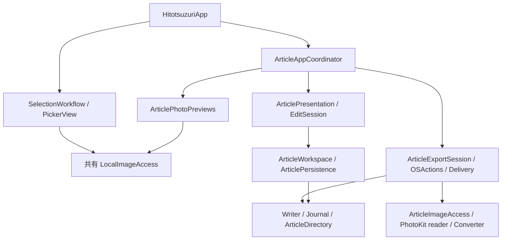
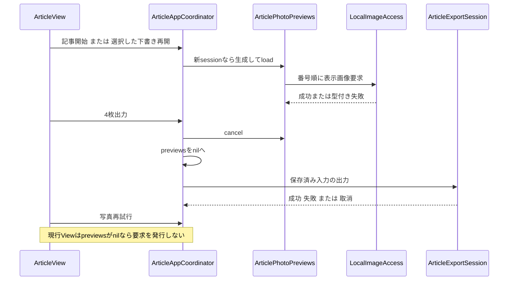

# Architecture Analysis

## System Overview
単一のSwiftUI/AppKitアプリとCore framework。MainActorのObservation状態、保存/出力actor、Photos adapter、fd相対ファイル操作を分離する。外部サーバーやDBはない。

## Component Relationships

<!-- Text fallback: Appは選択Workflowと記事Coordinatorを生成する。選択と記事表示はLocalImageAccessを共有し、記事出力は別のArticleImageAccessを使う。記事Presentationは保存へ、Exportは変換・Writer・Journalへ進む。 -->

## Data Flow
選択JSON→ArticleSource→保存記事の対応照合→EditSession→Coordinatorのsession同期→表示用Previews.load。表示と独立して手動保存・本文生成が可能。4枚出力は保存済み入力固定→パネル選択→一時生成→digest照合→排他的rename→journal確定。

## Key Design Decisions
表示と出力で要求・memory予算を分離する。出力開始前に表示画像を解放して同時保持を抑える。保存はoperation IDとexpected版・canonical digestを用いて競合と結果不明を処理する。出力は所有・実体identity・全生成bytesを照合し、不明物を消さない。

## Interaction Diagrams

<!-- Text fallback: 通常の新sessionは表示ownerを生成して取得する。出力は表示ownerを取消・破棄して実行するが、終端で再生成する接続がなく、同一sessionの再試行が要求を発行しない。本人の実機操作との因果はまだ未確定。 -->

## Improvement Opportunities
表示資源の解放と再開の責務を対にし、pending・解放中・失敗・再試行可能を正直に表現する余地がある。改善候補の採否は後続要件/計画で決める。本文/選択の保存形式やPhotoKit通信方針の変更はこの分析から必要とは判断していない。
