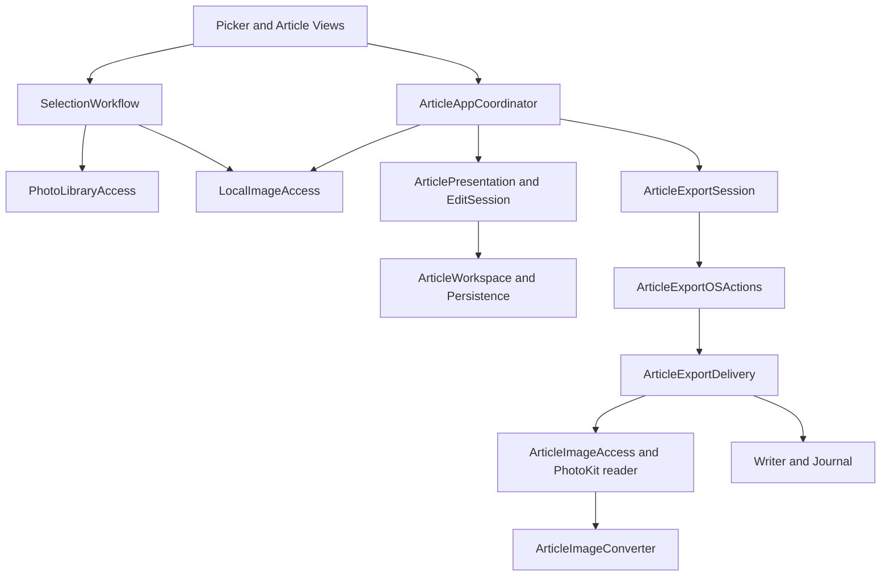
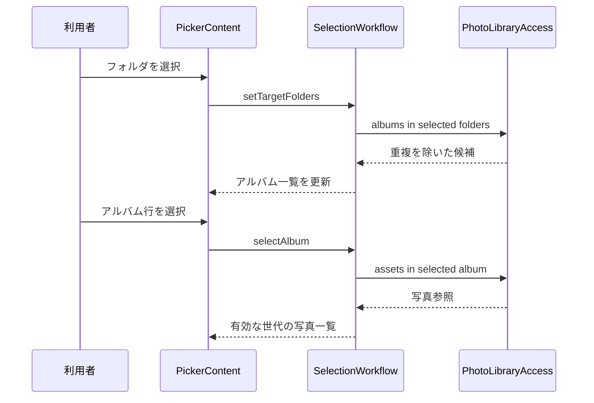
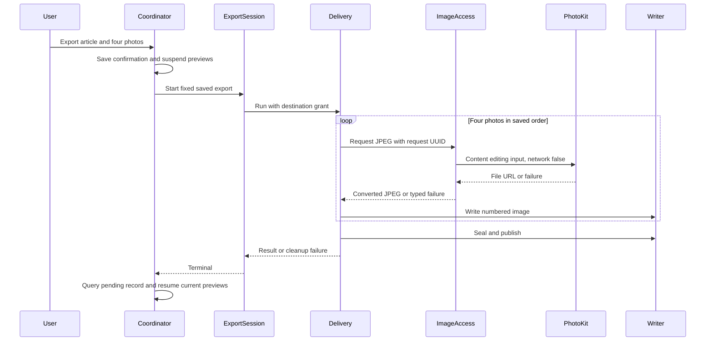

## Architecture Analysis

### System Overview

単一macOSアプリ＋Core framework。SwiftUI/AppKitの画面、MainActorの観測可能な状態、actorの永続化/出力、同期画像変換を分離する。backendはない。

### Architectural Style

protocolを介したadapter注入と状態機械。AppのArticleAppCoordinatorが画面/OS操作/資源を接続し、Coreが保存正本と出力の所有・確定を担当する。

### Component Relationships

図はflowchartのnode/edge構文を静的点検済み。テキスト代替: 選択画面はlibrary/display adapterを使い、記事Coordinatorは編集正本と出力Sessionを接続する。OSActionsが保存先grantを保持し、Deliveryが出力画像、Writer、Journalを順次制御する。

### Data Flow

選択はsettings.json/selection.json、記事はproject別operationsとcurrent、出力履歴はExportJobsのactive/job記録。出力は一時名で生成→4画像/本文/manifestをbytes照合→排他的rename→確定照合。生の写真bytesを恒久コピーせず、content editing inputのURLとownerを変換完了まで保持する。

### Key Design Decisions

- 保存時の固定入力とrevision/fingerprintから出力し、表示中の後編集を混入しない。
- 512px表示はLocalImageAccess、出力はPhotoKit編集入力＋JPEG変換。表示成功を原寸可用性の証拠にしない。
- MainActorの論理取消と同期変換/readerの実終端を分け、busy/予算/grantを実終端まで保持。
- Coordinatorは後照会まで出力所有を保持し、その後同じsessionの表示だけ復帰する。
- 写真/アルバム変更API、HTTP API、独自クラウド、配布CDはない。

### Improvement Opportunities

2026-11-06の調査では、出力時の通信許可、PhotoKit進捗→ExportProgress→UI、ダウンロード用期限、取消後の終端、分類した失敗/再試行を変更候補とした。保存/出力確定の設計は維持できる。詳細はapi-documentation.mdとcode-quality-assessment.md。

## Interaction Diagrams

### フォルダ選択からアルバム表示

テキスト代替。選択フォルダが変わると、Coreが対象の子孫も含めて一覧を作り直す。別のアルバムを選択すると、以前の写真と未確定の選択を解除し、写真参照の取得結果を画面に反映する。古い世代の取得結果は破棄する。

### 2026-11-06のiCloud出力調査時点の記録

sequenceDiagramのparticipant/loop/endと矢印を静的点検済み。テキスト代替: 保存確認・表示解放後、固定記事を渡し4枚を順次取得/変換/書込する。成功はseal/publish、失敗は実画像終端待ちとcleanup/照合へ進み、後照会が終わってから表示を復帰する。現状はPhotoKit download進捗の経路が存在しない。
