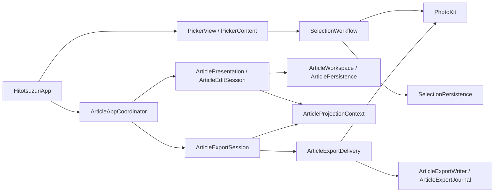
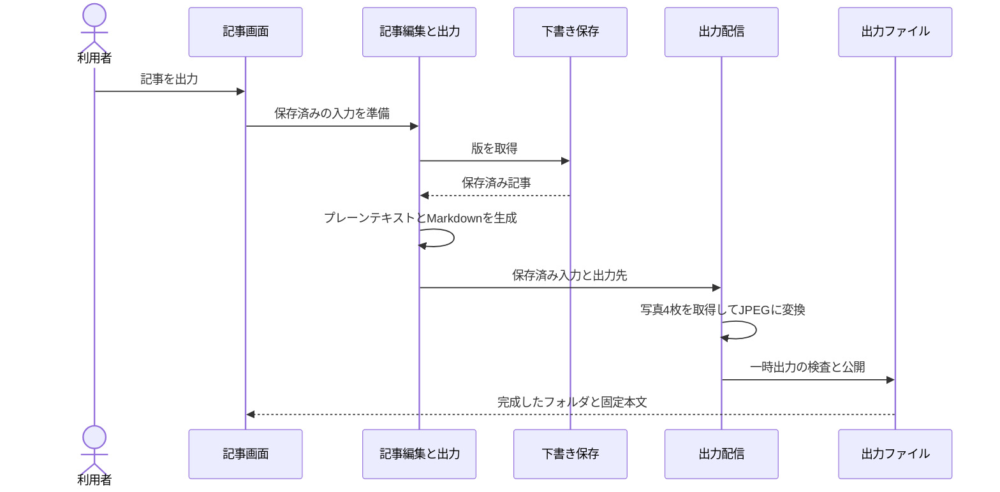

## Architecture Analysis

### System Overview

`HitotsuzuriApp` が写真選択と記事の画面、PhotoKit、ローカル保存を構成する。記事の画面遷移とOS操作を `ArticleAppCoordinator` が結線する。

### Architectural Style

単一のmacOSアプリとCoreフレームワーク。SwiftUIはObservationの状態を購読する。写真・ファイル・OSへの操作はプロトコルとアダプターを介し、保存と出力にactorを使う。

### Component Relationships

テキストでの説明。写真選択はPhotoKitと選択保存につながる。記事の画面と出力は記事変換を呼び、出力側で画像取得とファイル書込みを調整する。

### Data Flow

確定選択にアルバムと写真のID・順序を保存する。記事は選択にひも付いた本文等の編集内容と版を保存する。編集中のプレビュー・コピーは現在の内容から生成され、完成出力は保存済みのスナップショットから生成する。

### Key Design Decisions

- 画面画像と出力用JPEGは別の取得経路と寿命を持つ。
- エラー後の再試行や照合に備え、記事保存は操作IDと版、出力はジョブID・ディレクトリ実体・ファイルのダイジェストを記録する。

### Improvement Opportunities

プレビューの本文表示とプレーンテキスト・Markdownが共通の本文構成を使えるかが今回の変更点になる。既存出力の照合では、ジョブに結び付く旧形式の内容を維持できるか確認する。

## Interaction Diagrams

テキストでの説明。保存済み記事を変換し、写真4枚と一緒に一時出力へ書く。照合したフォルダを公開し、出力時に固定した本文を画面へ返す。
