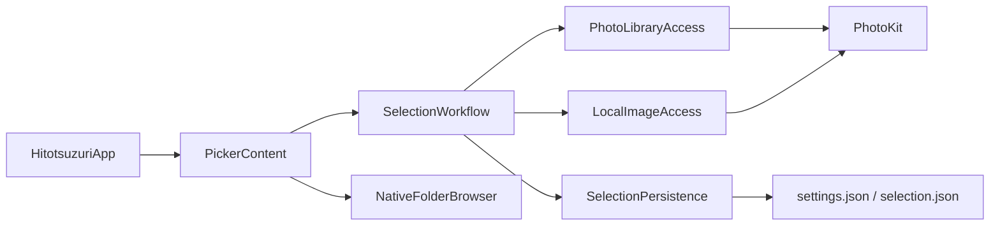
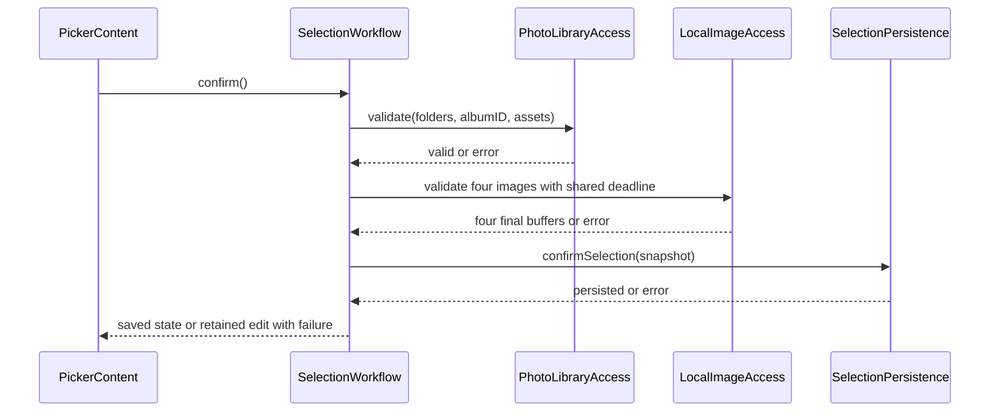

# 現行アーキテクチャ

## Architecture Analysis

### System Overview
単一macOSアプリと共有Core framework。SwiftUI画面はMainActorのObservableなSelectionWorkflowを参照し、プロトコル注入で写真・画像・保存を分離する。Coreには純粋なドメインだけでなくUIとAppKit/PhotoKit実装も同居する。

### Architectural Style
ローカルな状態管理とアダプタ境界を持つ単一アプリ。外部サービスや分散処理はない。SelectionPersistenceはactor、PhotoKitの一覧探索はTask.detached、UI公開状態と画像要求制御はMainActor。

### Component Relationships

テキスト代替: AppがUIとWorkflowを生成し、Workflowが写真参照・画像取得・保存の各境界を呼ぶ。UIのフォルダ操作はNativeFolderBrowserを介してWorkflowへ戻る。構文は宣言済みノード・括弧・矢印を目視確認した。

### Data Flow
ライブラリIDは不透明な文字列として渡す。表示画像はImageBufferの共有不変ストレージで保持し、描画プロバイダの寿命もカウントする。確定時は順序配列とアルバムを固定し、世代・編集revision・操作IDを照合して古い結果を排除する。

### Key Design Decisions
フォルダ設定と確定選択は別JSON、schemaVersion 1。復元候補は4枚全体成功後に公開。未知版・破損は通常保存で上書きしない。明示的再確定だけが破損原本をSHA256名で退避して回復する。参照は必要時の再検証で、PhotoKit変更通知による常時同期は実装していない。

### Improvement Opportunities
記事用画像と表示用取得の契約、記事の独立再開、手動下書き保存と離脱保護、選択IDの同一性はPhase2の追加設計点。現時点で存在しないサービスを現行構造へ書き加えない。

## Interaction Diagrams

テキスト代替: 4枚確定は現在参照・4枚画像の再検証、固定内容の永続化、成功状態の公開の順。途中失敗は旧確定と編集を保持する。参加者と呼出し構文を目視確認した。

起動時は認可確認、設定と選択の独立読込、階層探索、保存選択の所属・4枚画像検証、最後に一括公開を行う。認可や参照・画像の失敗時は編集表示をクリアし、保存原本は変更しない。
