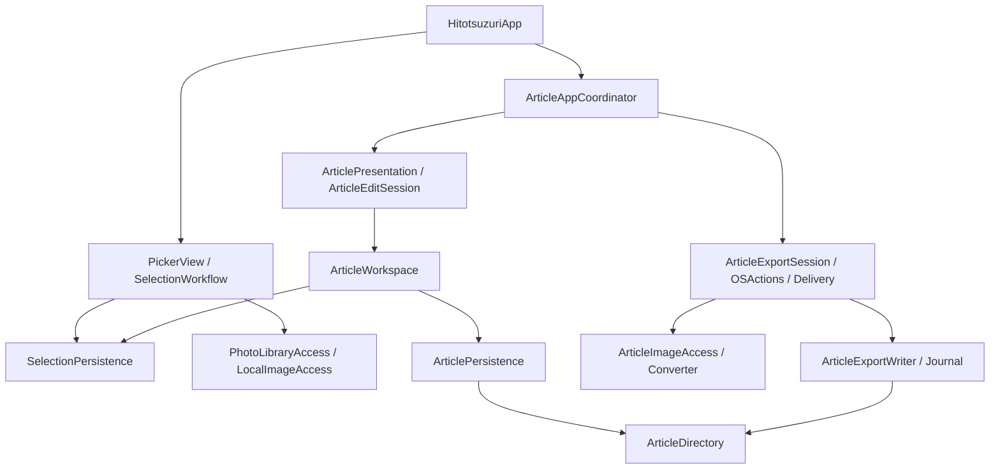
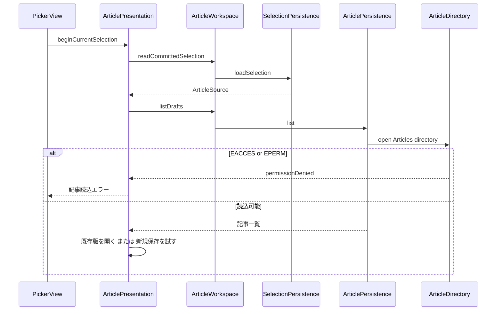

# Architecture Analysis

## System Overview
SwiftUI/AppKitの単一macOSアプリとCore frameworkで構成する。UI状態はMainActorのObservation、保存と出力はactor、画像変換・本文生成は分離した処理で扱う。外部サーバーやデータベースはない。

## Component Relationships

<!-- Text fallback: Appは選択Workflowと記事Coordinatorを生成する。記事画面はPresentationとWorkspaceを通して選択・記事保存へ進む。出力はSessionからOSActions、Delivery、画像変換とWriterへ進み、保存と出力はArticleDirectoryを共有する。 -->

## Data Flow
Application Support/Hitotsuzuriに確定選択を保存し、その `Articles/<projectID>/` に操作記録とcurrentを保存する。新記事は確定した4枚から初期化して保存を試す。既存記事の対応はselectionIDを優先し、同じalbumID・同じ写真順序の場合は候補を提示する。本文出力は保存済み版へ固定する。

## Key Design Decisions
小さなprotocolでOS依存を差し替える。記事の操作ID・入力digest・前版・currentを用いて再試行と競合を区別し、未知形式・破損を上書きしない。ファイル操作は開いた親fd相対で行いsymlinkを拒否する。出力先は本人のパネル選択で一時アクセスを保持し、再起動時は再選択を要する。

## Improvement Opportunities
親fd相対操作の安全性と、絶対パスの入口で全祖先を読取openする点を分離する必要がある。詳細は `code-quality-assessment.md`。既存の保存形式と写真選択の契約を変える必要性は見つかっていない。

## Interaction Diagrams

<!-- Text fallback: 記事開始は確定選択を読んでから記事一覧のディレクトリを開く。このopenで権限エラーになると写真プレビューを始める前に失敗表示する。成功時は既存版の再開か新規作成へ進む。 -->

出力は保存済み入力の固定→保存先選択とgrant→親実体identity取得→journal begin→一時folder生成→画像を順次変換・書込→全文とdigest照合→排他的rename→journal finish。中断時は記録・実体・digestを照合し、所有できないものは削除しない。
