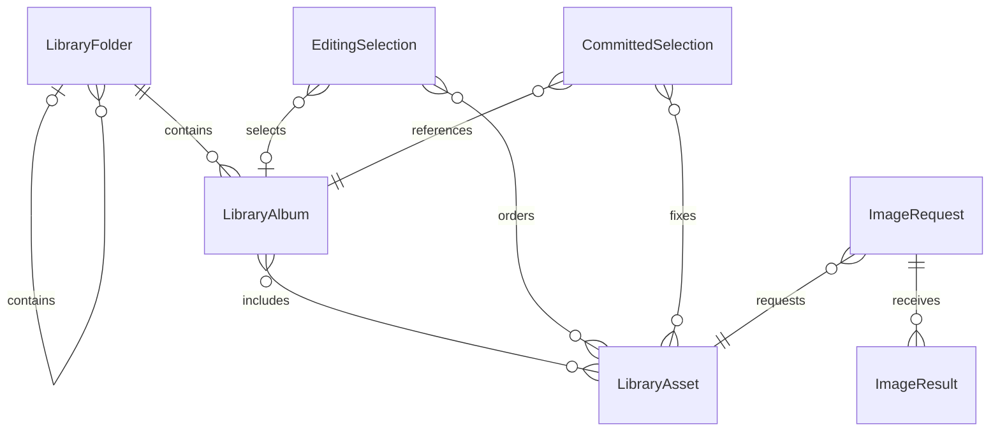

# U1 機能仕様

## 入力と範囲

[実装単位](../../../inception/units-generation/unit-of-work.md)、[割当](../../../inception/units-generation/unit-of-work-story-map.md)、[ストーリー](../../../inception/user-stories/stories.md)、[要件](../../../inception/requirements-analysis/requirements.md)、[構成要素](../../../inception/domain-design/components.md)、[内部契約](../../../inception/contract-design/contract-summary.md)、[確認内容](functional-design-questions.md)に基づく。対象はUS1.1〜US1.6とUS1.8のU1寄与。US1.7の復元はU2。データ形の正本は[entities.md](entities.md)、判断の正本は[rules.md](rules.md)、順序と遷移の正本は本書。U1は単独起動する最初のアプリだが、Phase 1全体の完成を意味しない。

## 処理の流れ

### F1 起動と許可

1. C1 startでC2の認可状態を確認する。未決定なら説明と許可操作を表示し、取得しない。
2. 本人の許可操作でのみ認可要求。許可応答後に階層の取得へ進む。拒否・制限・未対応はそれぞれの案内へ移る。
3. 設定の読込成功時は有効なフォルダだけ対象にする。保存済み確定レコードは旧内容の保護のため読めるが、写真選択の自動復元はU2で完成する。U1では復元完了を表示しない。
4. 保存なしは初期状態。破損・未知の保存版・読込失敗は区別して原本を変更しない。安全に編集を開始できても、書込が安全と確認できないレコードへの保存は拒否する。
5. 権限がない場合はライブラリ参照を行わず、保存データを権限不足のために削除しない。

### F2 フォルダ・アルバム

1. 対象フォルダIDの集合を受け取る。探索は各IDを起点とするスタックと訪問済み集合で進め、子フォルダを含めて全ユーザー作成アルバムを集める。
2. 同じIDは1回だけ採用する。親子同時選択でも重複しない。名称は照合に使わない。
3. 一覧の順序は階層の取得順での最初の出現順とし、選択フォルダの起点順は画面の階層順で固定する。写真の並びとは別の規則である。
4. 部分的な取得失敗を完全な対象一覧と誤認させない。現在のアルバムが対象内か不明なら確定できない。
5. フォルダ変更は設定保存と表示状態を調整する。設定保存失敗は現在の画面で明示し、次回起動に残ると約束しない。旧確定レコードを変更しない。
6. 対象内なら現在のアルバムと編集写真を保つ。対象外なら両方クリアする。別アルバム選択は編集写真をクリア、同じIDの再選択は維持する。
7. アルバム取得・画像要求の世代を更新する。古い結果を破棄し、不要画像要求を取り消す。

### F3 写真と画像

1. 対象アルバムの写真メタデータをC2から受け取り、写真以外を除外して相対順序を保つ。日時順への置換はしない。
2. 表示が必要な写真についてC3へ画像要求。表示用・選択枠用・確定検証用の目的と大きさを区別する。
3. 応答の要求ID・写真ID・世代が現在と一致するか確認する。取消後の応答は無視する。最終成功後に低品質の応答で表示を戻さない。
4. 読込中・取得不可・原因のある失敗・不明な失敗を分ける。取得不可をiCloudのためと無条件に断定しない。写真アプリでの準備と再起動を案内する。
5. 選択を許す画像成功の具体的品質条件はNFR Designで確定し、その条件に達するまで選択不可とする。暫定プレビューだけで確定検証を通さない。
6. 不要画像は解放する。通信要求への切替はない。待機上限と保持上限は技術設計で具体化する。

### F4 選択と変更

1. 選択済みIDなら解除し、後続番号を詰める。
2. 未選択で現アルバム内・取得可能・4枚未満なら末尾に追加。重複・取得不可・5枚目は内容を変えない。
3. 順序・枚数・確定可否を同じ編集状態から導出する。下部4枠に選択画像と番号を表示する。ドラッグ並べ替えは追加しない。
4. 編集後も旧確定内容は保持し、アルバムIDと写真IDの順序が旧確定と違えば未保存を表示する。フォルダ設定の保存状態は別に示す。
5. 検証・保存中の変更は受理しない。受理しなかった操作を完了後に自動再生しない。

### F5 確定・保存・再試行

1. 確定可能性を再確認し、4枚・アルバム・対象フォルダ・編集revisionを固定する。操作IDを割り当て、検証状態へ遷移する。
2. C2で現在の権限・アルバム存在と対象内所属・4枚存在とアルバム所属を検証する。応答のIDを固定した選択順に並べ直す。
3. C3で4枚のローカル画像取得可否を確認する。無効・取得不可・失敗・待機上限到達なら書込みへ進まない。不要な検証要求は取り消す。
4. 全条件を満たした固定データと確定日時をC4へ渡す。保存開始後はUI操作による取消・切替を受理せず、書込みの完了結果を待つ。
5. C4は設定と確定を別の論理レコードとして直列に書く。一時内容の準備・検証を終えてから旧内容を置換し、置換完了後だけ成功を返す。中断で半端な内容を正常レコードにしない。具体的なファイル操作と形式はNFR Designで決定する。
6. 操作IDと返された内容を照合し、成功後だけlastCommittedSnapshotを更新して保存済みを表示する。不一致は成功扱いにしない。
7. 書込み失敗は旧確定と編集を保持して案内する。再試行は本人操作によって手順1から再検証する。自動再試行しない。
8. 保存処理を単なる時間超過で未実施と見なして重ねて書き直さない。結果が未確定なら保存中を維持し、進行不能の案内を出す。終了後は原本の正常性を再確認する。
9. 未対応保存版は書込み拒否。破損確定レコードの退避後再確定はU2で完成し、U1では保護して上書きしない。
10. 外部ライブラリとの原子的な結合は保証しない。検証直後に外部変更が起きた場合は次回の確定・復元で検知する。

## 状態遷移

| 対象 | 現在 | 事象 | 次状態・効果 |
|---|---|---|---|
| 認可 | 未決定 | 本人が許可操作 | OS回答待ち、取得停止 |
| 認可 | 回答待ち | 許可 | 階層読込 |
| 認可 | 任意 | 拒否・制限・未対応を観測 | 取得停止と原因別案内 |
| 読込 | idle/ready/empty/failed | 対象を切替 | loading、世代更新 |
| 読込 | loading | 現世代で成功 | readyまたはempty |
| 読込 | loading | 現世代で失敗 | failed、確定不可 |
| 読込 | 任意 | 旧世代応答 | 変更なし |
| 画像 | pending | 暫定画像 | preview、成功条件未達なら選択不可 |
| 画像 | pending/preview | 最終画像成功 | final |
| 画像 | pending/preview | 取得不可・失敗 | unavailable/failed、案内 |
| 画像 | pending/preview/final | 不要・切替 | cancelled、応答不採用 |
| 保存 | idle/saved/failed | 有効な確定操作 | validating、編集禁止 |
| 保存 | validating | 全検証成功 | saving |
| 保存 | validating | 無効参照・画像失敗 | failed、旧確定と編集を保持 |
| 保存 | saving | 対応する保存完了 | saved、写し更新、編集再開 |
| 保存 | saving | 保存失敗 | failed、保持と再試行 |
| 保存 | validating/saving | 編集・再確定 | 状態変更なし |
| 保存 | failed | 本人の再試行 | validating、新しい検証 |
| 保存 | saved | 編集変更 | idle、未保存表示 |

画像のfinalはC3の最終成功を示す論理状態で、具体的解像度の約束ではない。保存のfailedには原因を付け、書込み再試行と再起動案内を区別する。

## データ関係の派生表示

テキスト代替: フォルダは子フォルダとアルバムを含み、アルバムは写真を順序付きで参照する。編集は最大4枚、確定は厳密に4枚を参照する。画像要求1件には0回以上の結果が届く。図のmany表現の厳密な上限はentities.mdの制約に従う。孤立した表示状態・設定・進行状態も同書に定義する。

## ルールの派生要約

| 規則 | 処理 |
|---|---|
| BR1.1 | 許可前取得禁止 |
| BR1.2〜BR1.4 | 再帰探索、順序、ローカル画像と古い応答排除 |
| BR1.5〜BR1.7 | 4枚制限と切替 |
| BR1.8〜BR1.11 | 内容固定・再検証・保存保護 |
| BR1.12〜BR1.14 | 外部変更、未保存、検証の区別 |

## 画面と内部境界

PickerPresentationはC1の一貫した表示状態を読む。フォルダ・アルバム・写真・4枠の画像と番号・枚数・確定操作・進行と失敗案内を最低限備える。選択ルールを画面側へ複製しない。幅切替・フォーカス・VoiceOverの完成はU3。画面が永続化やライブラリへ直接アクセスしない。U1はservice分類のため、独立したfrontend-components成果物は作らず、この節に最小UIの責務を記す。

## 検証と引継ぎ

- 認可・階層・画像・保存をFakeへ置換し、先に失敗テストを実行する。0〜5枚、循環、同名異ID、切替後の遅延応答、参照削除、書込み失敗・重複確定を含める。
- 実機で本人が権限、2フォルダ以上・3階層以上、手動並び、ローカル画像、4枚選択、保存を確認する。未確認は未確認と記録する。
- U2へ復元・破損退避・権限喪失等の全経路、U3へ最終UI・操作支援・測定を引き継ぐ。共有ACの部分寄与はtraceability.jsonに明記する。
- 保存形式・置換の具体策、画像品質と待機・保持上限、実行境界の具体型はNFR DesignとCode Generationの計画で整える。本書は技術非依存の動作仕様であり、未検証のSDKコードを成立済みとは扱わない。
- 最初の実装単位を検証する具体コマンドは本人確認待ち。アプリの実装・ビルド・テストは本段階で実施したとは記さない。

