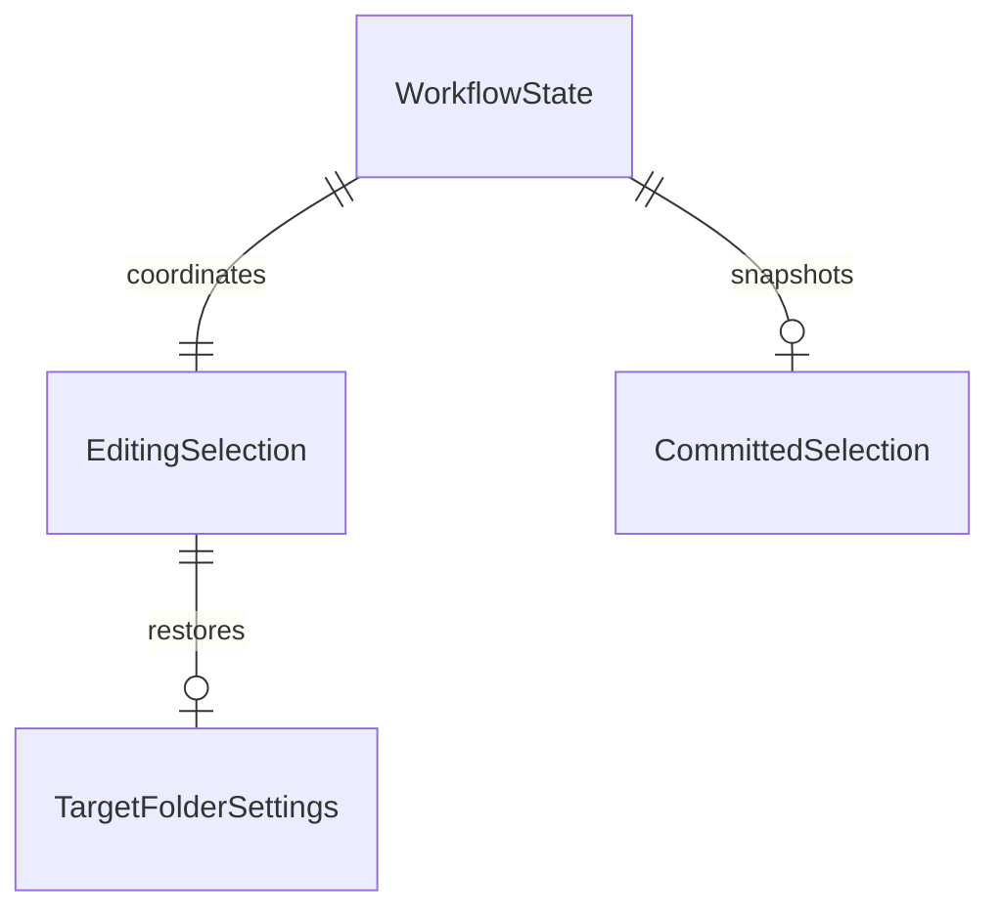

# U2 復元と失敗回復の仕様

根拠: [実装単位](../../../inception/units-generation/unit-of-work.md)、[割当](../../../inception/units-generation/unit-of-work-story-map.md)、[ストーリー](../../../inception/user-stories/stories.md)、[要件](../../../inception/requirements-analysis/requirements.md)、[構成要素](../../../inception/domain-design/components.md)、[契約](../../../inception/contract-design/contract-summary.md)。[CI省略](../../../change-decisions/2026-10-31-local-verification.md)を適用し、統合前ローカル検証を維持する。

対象はUS1.1、US1.3、US1.5〜US1.8のU2寄与。データの正本は[entities.md](entities.md)、判断は[rules.md](rules.md)、手順と遷移は本書。U1の認可・選択・画像期限・原本保護を利用し、U3の最終操作支援・性能を達成済みとしない。

## F2.1 起動と復元

1. 認可を確認する。未決定は本人の許可操作を待ち、拒否・制限・未対応なら参照検証をせず案内する。保存原本は保持する。
2. 設定と確定を別々に読み、保存なし/正常/破損/未知版/I/O失敗を区別する。設定の異常で確定原本を消さず、確定の異常でも正常設定の利用を妨げない。
3. 許可後に階層を読み、有効な対象フォルダだけを画面へ復元する。保存なしなら対象未選択。設定が読めなければ空の安全な対象状態と原因案内にし、不明な対象内判定で写真を復元しない。
4. 確定が正常なら、保存したアルバムが現在の対象内で存在するか、4枚すべてが存在し所属するかを現在の参照で確認する。ID照会の結果を保存順に戻す。
5. 4枚すべての最終ローカル画像取得を確認する。画像1件と全4枚の期限はそれぞれ15秒の早い方。通信なし・取消と古い応答不採用は継続する。
6. 全成功時だけアルバム・4枚の順序・日時・確定状態を一括で公開する。復元途中は編集禁止で、部分的に成功した写真を選択へ流し込まない。
7. 写真1枚でも欠損/取得不可、アルバム削除/対象外なら写真全体と編集中アルバムをクリアし、有効フォルダを残して案内する。原本の削除・置換はしない。復元できない原本を有効な保存済みとして画面に表示しない。
8. 起動や復元の古い結果は世代と操作IDで破棄する。権限喪失が観測されたら参照検証を止め、状態を案内する。OS変更の自動監視や手動更新ボタンは作らない。

## F2.2 編集・確定・再試行

復元後の変更は編集状態のみへ反映し、最後の確定の写しを保持する。別アルバムは編集写真クリア、同一アルバムは保持。フォルダ変更でアルバムが対象外なら編集アルバムと写真をクリアし、古い成功案内を消す。設定保存の成否と4枚確定の成否を別に示す。

確定と再試行は編集revisionと内容を固定し、現在権限・参照・所属・画像を再検証する。検証・書込中は編集と重複確定を拒否し、入力を後で再生しない。書込成功と要求ID/内容が一致してから確定を更新する。失敗は旧確定と編集を保持し、本人が再試行できる。結果未確定の書込を時間超過だけで二重開始しない。

## F2.3 破損原本と未知版

起動時や単なる設定変更では破損確定を上書きしない。新しい有効4枚を本人が明示的に確定した時だけ、破損原本の同一内容を退避して検証し、新規内容を置換する。退避が作れない/検証できない/置換失敗なら成功にせず原本と編集を保持する。退避対象が読込後に変わっていれば上書きせず再確認案内とする。未知版は退避経由でも上書き拒否。

破損した設定は空へ自動上書きせず、失敗案内と原本保護を維持する。今回の回復の対象は本人の明示的な4枚確定に伴う破損確定レコード。設定の手動修復が必要なら日本語手順で本人へ案内し、自動削除はしない。

## 遷移

| 現在 | 事象 | 次状態 |
|---|---|---|
| notStarted | 開始 | loading、認可確認 |
| loading | 許可なし | blocked、権限案内 |
| loading | 許可と正常確定 | validating、編集禁止 |
| loading | 保存なし | missing、安全な初期状態 |
| loading | 破損/未知版/I/O失敗 | failed、原本保持 |
| validating | 全4枚成功 | restored、一括公開 |
| validating | 1件でも無効/失敗 | failed、全写真クリア・有効フォルダ保持 |
| restored | 編集変更 | 編集中、旧確定は保持 |
| 編集中/保存失敗 | 確定/再試行 | validating→saving |
| saving | 成功 | saved、旧確定の写しを更新 |
| saving | 失敗 | failed、編集と旧確定保持 |
| 任意 | 古い世代の結果 | 変更なし |

## 関係の派生図

テキスト代替: 進行状態は編集状態を1つ管理し、最後の確定の写しを任意に保持する。編集には有効な設定の写しを復元する。多重度と属性の正本はentities.md。

## ルールの派生要約と検証

BR2.1〜BR2.5は認可・読込・復元の一括適用、BR2.6〜BR2.8は編集分離・再試行・破損退避、BR2.9〜BR2.10は回復案内と検証。正常/欠損1枚/アルバム削除/対象外/画像不可/権限なし/破損/未知版/書込失敗/古い応答/重複操作をFake・注入時計・専用保存先でTDD検証する。最後の確定だけを再起動対象とし、未保存編集は復元しない。本人の保存・終了再起動・外部削除確認は別に記録する。

