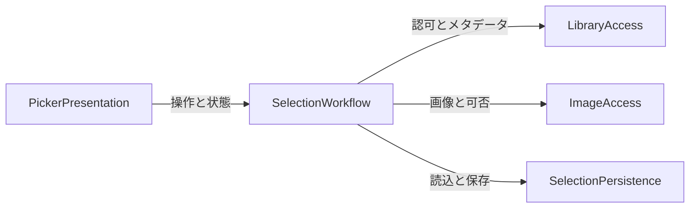

# ひとつづり — 構成要素と責務

入力: [要件](../requirements-analysis/requirements.md)、[ストーリー](../user-stories/stories.md)、[開発規約](../practices-discovery/team-practices.md)、[確認済み方針](domain-design-questions.md)。詳細な型・制約・関係の多重度はFunctional Designへ残す。以下の属性名は形と所有者の整理であり完全なスキーマではない。

## Component Catalogue

```yaml
{
  "components": [
    {
      "name": "PickerPresentation",
      "summary": "画面表示と入力の橋渡し",
      "behaviour": "受け取った状態を表示し操作を進行担当へ渡す。4枚ルール・保存成功・認可を独自判断しない。キーボードとVoiceOverへ意味を提供する。",
      "responsibilities": [
        "3領域と狭い幅の切替",
        "選択プレビューと状態文",
        "フォーカス・表示上の展開状態"
      ],
      "depends_on": [
        {
          "component": "SelectionWorkflow",
          "interaction": "表示状態の参照とユーザー意図の実行",
          "style": "async"
        }
      ],
      "dependents": [],
      "entities": [
        {
          "name": "PresentationContext",
          "identifier": "viewID",
          "attributes": [
            "focusedItemID",
            "activeRegion",
            "expandedFolderIDs"
          ]
        }
      ]
    },
    {
      "name": "SelectionWorkflow",
      "summary": "選択・確定・復元の判断と進行",
      "behaviour": "編集状態と保存済みの写しを区別し、4枚制限と順序・状態遷移を一元管理する。確定前に参照と画像を確認し保存成功後だけ確定を表示する。保存中の編集を禁止する。",
      "responsibilities": [
        "選択の追加・解除と順序",
        "アルバム・フォルダ変更時の整合性",
        "確定検証・保存・復元の調整",
        "遅延結果の採用判断と失敗回復"
      ],
      "depends_on": [
        {
          "component": "LibraryAccess",
          "interaction": "認可・階層・アルバム・写真・現在の参照を確認",
          "style": "async"
        },
        {
          "component": "ImageAccess",
          "interaction": "ローカル画像と取得可否を要求・取消",
          "style": "async"
        },
        {
          "component": "SelectionPersistence",
          "interaction": "設定・確定内容を読込み、保存成功を待つ",
          "style": "async"
        }
      ],
      "dependents": [
        {
          "component": "PickerPresentation",
          "interaction": "状態表示とユーザー操作"
        }
      ],
      "entities": [
        {
          "name": "EditingSelection",
          "identifier": "editingSessionID",
          "attributes": [
            "targetFolderIDs",
            "activeAlbumID",
            "orderedAssetIDs",
            "availability",
            "revision"
          ],
          "references": [
            {
              "entity": "LibraryAlbum",
              "owned_by": "LibraryAccess",
              "relationship": "編集中アルバムをIDで参照する"
            },
            {
              "entity": "LibraryAsset",
              "owned_by": "LibraryAccess",
              "relationship": "選択写真をIDで参照する"
            }
          ]
        },
        {
          "name": "WorkflowState",
          "identifier": "workflowID",
          "attributes": [
            "authorization",
            "loadState",
            "saveState",
            "restoreState",
            "lastCommittedSnapshot",
            "error",
            "requestGeneration"
          ],
          "references": [
            {
              "entity": "CommittedSelection",
              "owned_by": "SelectionPersistence",
              "relationship": "最後の保存成功内容を変更不能な写しとして参照する"
            }
          ]
        }
      ]
    },
    {
      "name": "LibraryAccess",
      "summary": "写真ライブラリの認可とメタデータ参照",
      "behaviour": "許可を得てシステム写真ライブラリの階層・写真を読み取る。写真ライブラリへの変更を提供しない。写真の取得順を保持し、参照の存在・所属を問い合わせられるようにする。",
      "responsibilities": [
        "認可状態と要求",
        "階層・アルバム・写真情報の取得",
        "IDと所属の再検証"
      ],
      "depends_on": [],
      "dependents": [
        {
          "component": "SelectionWorkflow",
          "interaction": "ライブラリ情報と有効性の問合せ"
        }
      ],
      "external_dependencies": [
        {
          "name": "PhotoKit / macOS Photos",
          "kind": "third-party-api",
          "purpose": "システム写真ライブラリの認可と読み取り"
        }
      ],
      "entities": [
        {
          "name": "LibraryFolder",
          "identifier": "folderID",
          "attributes": [
            "title",
            "parentFolderID",
            "childFolderIDs",
            "albumIDs"
          ]
        },
        {
          "name": "LibraryAlbum",
          "identifier": "albumID",
          "attributes": [
            "title",
            "parentFolderID",
            "orderedAssetIDs"
          ]
        },
        {
          "name": "LibraryAsset",
          "identifier": "assetID",
          "attributes": [
            "creationDate",
            "mediaKind",
            "pixelWidth",
            "pixelHeight"
          ]
        }
      ]
    },
    {
      "name": "ImageAccess",
      "summary": "通信を要求しない画像取得と要求の生存管理",
      "behaviour": "写真IDと表示用途から画像を要求する。取得中・取得成功・取得不可を区別し、不要な要求を取消す。画像取得通信を許可しない。過去の要求の結果を識別して返す。",
      "responsibilities": [
        "サムネイルの取得と結果",
        "要求の取消・表示画像の解放",
        "画像取得可否の確認"
      ],
      "depends_on": [],
      "dependents": [
        {
          "component": "SelectionWorkflow",
          "interaction": "画像と可否を要求・取消"
        }
      ],
      "external_dependencies": [
        {
          "name": "PhotoKit image APIs",
          "kind": "third-party-api",
          "purpose": "ローカル画像の取得"
        }
      ],
      "entities": [
        {
          "name": "ImageRequest",
          "identifier": "requestID",
          "attributes": [
            "assetID",
            "displayPurpose",
            "targetSize",
            "generation",
            "state"
          ],
          "references": [
            {
              "entity": "LibraryAsset",
              "owned_by": "LibraryAccess",
              "relationship": "画像の対象を写真IDで識別する。直接の呼出し依存ではない"
            }
          ]
        },
        {
          "name": "ImageResult",
          "identifier": "resultID",
          "attributes": [
            "requestID",
            "assetID",
            "image",
            "quality",
            "failureReason"
          ]
        }
      ]
    },
    {
      "name": "SelectionPersistence",
      "summary": "設定と最後の確定内容の永続化",
      "behaviour": "専用領域で設定と確定内容を読み書きし、書込み失敗で前の確定内容を壊さない。画像本体や編集中状態を保存しない。ライブラリの有効性判断は進行担当に返す。",
      "responsibilities": [
        "保存形式の読込み・書込み",
        "保存成功・失敗の通知",
        "破損・未対応形式の検出"
      ],
      "depends_on": [],
      "dependents": [
        {
          "component": "SelectionWorkflow",
          "interaction": "設定と確定内容の読込み・保存"
        }
      ],
      "external_dependencies": [
        {
          "name": "アプリ専用のローカル保存領域",
          "kind": "other",
          "purpose": "設定と確定参照の保存"
        }
      ],
      "entities": [
        {
          "name": "TargetFolderSettings",
          "identifier": "settingsID",
          "attributes": [
            "folderIDs",
            "formatVersion"
          ]
        },
        {
          "name": "CommittedSelection",
          "identifier": "selectionID",
          "attributes": [
            "albumID",
            "albumTitle",
            "orderedAssetIDs",
            "confirmedAt",
            "formatVersion"
          ],
          "references": [
            {
              "entity": "LibraryAlbum",
              "owned_by": "LibraryAccess",
              "relationship": "確定元のアルバムをIDで参照する"
            },
            {
              "entity": "LibraryAsset",
              "owned_by": "LibraryAccess",
              "relationship": "確定した写真を順序付きIDで参照する"
            }
          ]
        }
      ]
    }
  ]
}
```

## Component Diagram



テキスト代替: 画面は進行担当だけを呼び、進行担当がライブラリ参照・画像取得・保存を呼ぶ。下位の3担当同士は呼び合わない。エンティティのID参照は呼出し依存と区別する。

## Component Summary

| Component | Purpose | Depends On | Dependents | Entities Owned |
|---|---|---|---|---|
| PickerPresentation | 画面表示と入力の橋渡し | SelectionWorkflow | なし | PresentationContext |
| SelectionWorkflow | 選択・確定・復元の判断と進行 | LibraryAccess, ImageAccess, SelectionPersistence | PickerPresentation | EditingSelection, WorkflowState |
| LibraryAccess | 写真ライブラリの認可とメタデータ参照 | なし | SelectionWorkflow | LibraryFolder, LibraryAlbum, LibraryAsset |
| ImageAccess | 通信を要求しない画像取得と要求の生存管理 | なし | SelectionWorkflow | ImageRequest, ImageResult |
| SelectionPersistence | 設定と最後の確定内容の永続化 | なし | SelectionWorkflow | TargetFolderSettings, CommittedSelection |

## Entity Ownership

| Entity | Owning Component | Identifier | Attributes | References |
|---|---|---|---|---|
| PresentationContext | PickerPresentation | viewID | focusedItemID, activeRegion, expandedFolderIDs | なし |
| EditingSelection | SelectionWorkflow | editingSessionID | targetFolderIDs, activeAlbumID, orderedAssetIDs, availability, revision | LibraryAlbum / LibraryAccess, LibraryAsset / LibraryAccess |
| WorkflowState | SelectionWorkflow | workflowID | authorization, loadState, saveState, restoreState, lastCommittedSnapshot, error, requestGeneration | CommittedSelection / SelectionPersistence |
| LibraryFolder | LibraryAccess | folderID | title, parentFolderID, childFolderIDs, albumIDs | なし |
| LibraryAlbum | LibraryAccess | albumID | title, parentFolderID, orderedAssetIDs | なし |
| LibraryAsset | LibraryAccess | assetID | creationDate, mediaKind, pixelWidth, pixelHeight | なし |
| ImageRequest | ImageAccess | requestID | assetID, displayPurpose, targetSize, generation, state | LibraryAsset / LibraryAccess |
| ImageResult | ImageAccess | resultID | requestID, assetID, image, quality, failureReason | なし |
| TargetFolderSettings | SelectionPersistence | settingsID | folderIDs, formatVersion | なし |
| CommittedSelection | SelectionPersistence | selectionID | albumID, albumTitle, orderedAssetIDs, confirmedAt, formatVersion | LibraryAlbum / LibraryAccess, LibraryAsset / LibraryAccess |

## External Dependencies

| Component | Dependency | Kind | Purpose |
|---|---|---|---|
| LibraryAccess | PhotoKit / macOS Photos | third-party-api | システム写真ライブラリの認可と読み取り |
| ImageAccess | PhotoKit image APIs | third-party-api | ローカル画像の取得 |
| SelectionPersistence | アプリ専用のローカル保存領域 | other | 設定と確定参照の保存 |

## Rationale

| 構成要素 | 分ける理由 |
|---|---|
| PickerPresentation | フォーカス・幅・表示の変更をルールから切り離す |
| SelectionWorkflow | 選択・確定・復元の判断を一箇所でテストする |
| LibraryAccess | 認可・階層・所属の参照を実ライブラリから置換可能にする |
| ImageAccess | 多段の画像応答・取消・資源寿命をメタデータ探索から分ける |
| SelectionPersistence | 書込み失敗・破損と保存済み内容の寿命を分ける |

比較: Aの5分割は境界の数が増えるがFakeによる個別検証が容易。Bの3分割（画面と選択・ライブラリと画像・保存）は初期の接続が少ない反面、非同期画像と探索、表示と確定判断が密になる。本人はAを選択し要約確認済み。Alternatives Rejected: Bは今回のTDDと失敗条件の独立検証を優先して採用しない。各View単位に判断を分散する案も、選択ルールの重複と状態不整合を増やすため採用しない。詳しくは[設計判断](decisions.md)。

## 境界上の整合性

編集と最後の確定内容を分ける。保存結果は要求の世代と内容を照合し成功後だけ反映する。保存中は編集禁止。復元は保存担当がデコード、進行担当がライブラリと画像を検証し、欠損があれば写真選択全体をクリアする。表示だけの状態と保存済み設定のコピーは所有データの移譲ではなく読み取り用の写しとして扱う。認可状態はLibraryAccessの観測結果をWorkflowStateへ反映する。

## 保護と未確定事項

ライブラリ変更・画像取得通信・写真本体の恒久保存を提供しない。UIは専用保存領域へ直接触らない。アルバム順の一致、保存形式と原子性、画像応答の品質判定・資源上限、MainActor等の実行境界、公開APIは後続設計・計画で具体化する。新しい配布単位・技術スタック・クラウド配置はここで決めない。
