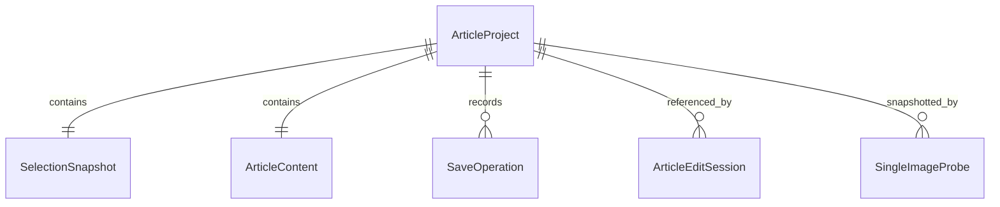

# U1 記事保存・再開と画像1枚出力

## 入力・担当と正本
`../../../inception/units-generation/unit-of-work.md`、`unit-of-work-story-map.md`、`../../../inception/user-stories/stories.md`のUS1.1〜1.4/1.7、`../../../inception/requirements-analysis/requirements.md`、`../../../inception/domain-design/components.md`、`../../../inception/contract-design/contract-summary.md`と確認済みQ&Aを入力とする。データ形状はentities.mdのYAML、判定規則はrules.mdのYAML、操作順序と状態遷移は本書が正本。

U1は最小統合差分。U2の候補選択・全編集体験/日付、U3のコピー/Finder・4枚/Markdown/manifestを実装済みとしない。本文の基本全欄はU1で提供し、撮影情報は保存型に保持するが候補生成/入力フォームはU2で完成する。既存記事を開く際にフィールドを既定値で置換しない。

## 記事開始・再開
1. 同じ記事操作の二重起動を単一調整点でまとめる。既存選択の永続データを画像成功に依存せず読み、既存形式版1・順序付き4つの異なるID・必須値を検証する。
2. 独立した記事領域を読む。選択IDを関連付け済みの記事が1件ならそれを開く。記事単位の不在・破損・未知版・権限/I/O失敗を区別する。1件の破損で正常記事一覧を0件にしない。
3. 同一選択の関連がなく、同じアルバム/順序4枚の別選択候補があれば、U1では既存記事を保護して「この選択には再開候補があります。候補選択は後続機能で対応」と案内する。U2が新規/再開/取消を完成する。U1の既存projectID指定再開は利用可能。
4. 関連候補がなく読込不確実性もなければ、operationIDとprojectIDを書込前に発行し、sourceの写しと基本本文欄を作る。日付候補生成はU2の担当、本文は空。タイトルはU1では元アルバム名を仮入力として編集可能にし、U2で承認済み接尾辞規則を適用する。これはU1途中状態でありFR8〜10の完成ではない。
5. 初期保存を確定できたらcleanで開く。失敗なら新規作業コピーをnewUnsavedとして保持し、同じprojectID/operationIDの照合後に再試行できる。重複開始が別記事を作らない。
6. 保存記事を開いた後、写真表示は別に要求する。写真番号と取得状態を表示し、取得不能でも本文・既存撮影情報の読込/編集/保存を続ける。画像成功待ちで記事画面全体を止めない。

未保存の別記事が開いていれば、開始前に下記の離脱確認を完了する。旧記事を読込失敗のまま「新規なし」と判断しない。U2完成前の候補操作を、危険な自動作成で代用しない。

## 手動保存と再起動後照合
1. 作業内容を検証し、operationID・expectedRevision・入力全体のdigest・editGenerationを固定する。保存中の重複要求を受け付けない。
2. 正本所有者は書込を直列化し、対象の形式版、projectID、保存版と読込時の保存物識別を確認する。変更があればconflictを返し、作業入力も旧正本も置換しない。
3. 記事結果と操作記録を同一の確定単位にする。確定前は旧結果が読め、確定後は結果とoperationIDを共に読める。途中物を正常記事として列挙しない。確定点を越えた取消は成功で返す。
4. 同一内容ならsavedRevisionを増やさず、操作の成功結果を照合可能にする。変更内容があれば+1。新規は1。整数上限時は失敗し巻き戻って0にならない。
5. 操作IDが既に確定していれば、入力digestが一致するとその時の保存結果を返す。異なる入力はinvalidInput。応答不明ならprojectIDとoperationIDを読んで照合し、未確定と確認できた場合のみ同じ操作を再実行する。
6. 応答のsessionID/operationIDを照合し、現在の基準保存版を更新する。現在入力が保存した写しと同じならclean、違えばdirty。保存成功だけで新しい入力を保存済みにしない。

### 内部保存構造と競合保護
記事ごとに、版付きの記事と操作結果集合を1つの論理トランザクションとして扱う。結果履歴は再試行の内部照合用で、UIの制作履歴/版復元機能ではない。保存領域の索引は派生情報とし、失われても記事レコードから再構築する。索引更新失敗を理由に記事を再作成しない。

保存構造は不変の操作レコード＋確定参照の切替を採用する。各記事の確定参照は最新操作を指し、その操作は前の確定操作への参照・operationID・入力digest・resultSnapshotを持つ。候補操作レコードを書き終えてから確定参照を原子的に切り替える。これが唯一の確定点で、未参照候補だけでは成功にならない。変更なし保存も操作記録を持つがsavedRevisionは維持する。過去operationIDは確定鎖を辿って元結果を返す。

再起動時は確定鎖を検証し、破損/未知版の参照を勝手に最新候補へ置換しない。未参照候補は再試行前に照合/片付ける。参照なしの新規作成失敗と既存記事の参照読込失敗を区別する。索引は確定参照から再構築する。

代替の単一封筒置換は、操作結果が増えるたびに全履歴の再書込/展開を招くため不採用。不変レコード方式は容量と参照検査の負担を持つ。元結果保証を維持するため確定済み操作を自動削除しない。照合は逐次読込で全履歴を同時展開せず、容量/応答予算・中断可能な読込・ディスク不足時の保護をNFR Designで定める。原子的参照切替・耐障害性・排他更新は後続設計でOS上の成立性を検証してからコードへ進む。

アプリ内部の全入口は同じ正本所有者と編集セッションを使う。別プロセスの同アプリによる書込は排他的調整または拒否で保護する。外部編集との競合は確定直前まで保存物の識別を再確認し、OSの調整方式の保証範囲をInfrastructure Designで明示する。任意の外部プログラムによる非協調書換えを完全防止したと約束しない。

## 未保存離脱
1. 戻る/閉じる/終了/切替をpendingNavigationとして保持する。
2. dirty/newUnsaved/failed/conflictなら3択をキーボードで提示する。cleanなら離れる。savingなら結果を待ち、保存した写しと現在入力を再比較する。
3. 「保存して離れる」は現入力を手動保存し、入力が保存した内容と一致した成功時のみ離れる。新編集があれば離れず再確認する。
4. 「保存せず離れる」は作業コピーだけ破棄し、旧記事と初期骨組みの保存は削除しない。失敗した初期作成の作業コピーを明示破棄する場合は未保存部分だけを捨てる。
5. 「編集継続」/確認取消はpendingNavigationを解除して入力と焦点を保持する。保存失敗は離れずfailed/conflictを示す。強制終了時の未保存復旧は対象外。

## 画像1枚の検証出力
1. 未保存なら保存/取消を求め、保存成功の写しを固定する。初期保存失敗・保存取消で画像要求を始めない。
2. 利用者が出力先を選ぶ。取消は編集へ戻る。権限なしは理由を示す。アクセスの寿命は当該ジョブ全体を覆い、全終端で解放する。
3. 固定記事の先頭assetIDを記事用設定で取得する。通信を要求せず、現在編集/向き反映の静止画を使う。表示用512pxで代用せず、ローカル取得不能は事前取得と再試行を案内する。
4. sRGB、JPEG品質0.9、長辺2560以下、拡大なし、不要元メタデータなしへ変換する。Live Photoは静止画。HEIF/RAW等も取得可能な現在編集画像を対象とし、取得不能を合成画像で隠さない。
5. 内部生成IDの一時領域に1枚を作り、復号可能性・寸法・形式を確認する。出力名にアルバム名/外部IDを使わない。指定先内に新しい検証専用フォルダを排他的に確定し、既存物を上書きしない。
6. 成功時は「画像1枚の検証出力」と保存先を示す。article.md/manifest/4枚セットは生成しない。保存内容・順序を後から書き換えず、元写真にも書込まない。

### ジョブの終端と復旧
selectingDestination→acquiring→converting→writing→committing→succeeded。確定前の各状態はcancelling→cancelled、失敗はfailedへ遷移。一時物削除に失敗した場合はcleanupFailedで残存場所を示す。取消要求だけでは完了にせず、確定成功後の取消要求はsucceededのまま。応答不明はrequestID/出力識別で結果を照合し、盲目的な重複出力をしない。新しい本人の再出力には新requestIDを使う。

再起動時はジョブ識別付きの未完一時物を未成功として扱い、当該一時物だけ案内/片付ける。別ジョブ・旧完成成果物を削除しない。確定済み結果が見つかった場合は結果整合を確認し、単なる一時物の存在を成功にしない。物理記録方式・確定点の成立性はNFR/Infrastructure Designで確認する。

全画像要求はdeadlineを持つ単一終端、遅延応答はrequestIDと世代で排除。具体的な秒数/メモリ量/並列数はNFR Requirementsで確定してから実装する。進捗は処理段階と任意割合を表示し、未知割合を0%完了と断定しない。

## 状態遷移の正本
| 現状態 | 事象 | 次状態・効果 |
|---|---|---|
| newUnsaved/dirty/failed/conflict | 手動保存 | saving、対象写しと操作IDを固定 |
| clean | 編集 | dirty、generation増加 |
| saving | 編集 | savingのまま作業コピーを更新、保存対象は不変 |
| saving | 正しい操作の成功 | 同じ入力ならclean、違えばdirty、基準保存版更新 |
| saving | 失敗/競合 | failed/conflict、入力と旧正本保持 |
| 任意 | 古いsession/operationの結果 | 状態変更なし |
| dirty等 | 離脱要求 | 確認待ち、まだ離れない |
| 確認待ち | 継続/取消 | 元の編集状態、入力保持 |
| 確認待ち | 明示破棄 | 作業コピーのみ破棄し離脱 |
| 確認待ち | 保存選択 | 成功かつ現内容と一致時のみ離脱 |

## 共通指紋と後続への接続
共通指紋算出の所有はArticleWorkspace。sourceとcontentの定義順の値を版付きcanonical形式で符号化しdigestにする。文字のUnicode正規化・trim・改行変換は行わず、入力コードポイントと配列順を保持する。nullと空文字、数値と文字を区別し、フィールド名/型/値の長さを含めて連結の曖昧さをなくす。年月日は整数3要素、時点は共通のUTC精度表現。指紋形式版、厳密なバイト符号化、digestアルゴリズムと基準ベクトルはNFR Designで固定し、U2がそれを利用する。projectID・保存日時・保存版・sourceSelectionIDsの追加関連は本文指紋外で別照合。

受容済み契約懸念R-01はU2の投影入力にprojectIDを明示する具体化へ引継ぎ、runExportのsavedInputとrenderedのprojectID照合を後続で成立させる。U1はC3の後続型を参照しない。R-02は共通算出責務を上記で具体化し、別実装を避ける。上流契約の版/変更管理が必要なら差分を該当設計へ明示する。受容という判断を修正依頼と記録し直さない。

## 派生ER図と規則一覧

テキスト代替: 記事は選択写しと内容を1つずつ持つ。保存操作、編集セッション、検証画像ジョブは記事を参照する。データ形状はentities.mdを優先。構文のerDiagram・識別子・関連演算子・ラベルを確認済み。

| 規則 | 動作 |
|---|---|
| BR1.1/BR1.2 | 同一性・4枚順序・文字保持 |
| BR1.3/BR1.4/BR1.5 | 手動保存・保護・離脱 |
| BR1.6/BR1.7 | 写真なし文章継続・安全な記事画像 |
| BR1.8/BR1.9 | 保存済み1枚出力と終端 |
| BR1.10/BR1.11 | ログ保護・共通指紋 |

## 失敗・境界と試験への引継ぎ
単一ローカル利用で、アカウント/テナント/ネットワークAPIは対象外。ファイル不在/権限/容量/途中物/シンボリックリンク/別名/外部変更は保存境界で検証し、指定ルート外へ出ない。非正規名・未知ファイルを記事として自動採用しない。1件破損と全読込失敗を区別。空文字・日本語・改行・結合文字・引用符・長い語は保存往復とUIで試験し、本文を実行しない。数値の0/負数/上限、日付の欠損/不正は境界失敗とし、自由本文に恣意的上限を追加しない。

各主要経路は正常と2つ以上の失敗/境界をTDDで確認。新規/再開二重操作、保存前後取消、古い完了、新編集、未知版・破損・競合、元写真変更API非呼出し、ネットワークfalse、画像1枚の実変換、保存先取消/容量/片付け失敗、再起動照合を単体/統合/UIへ割当てる。合成画像での一連の操作を承認済み検証コマンドへ組込み、実写真/色/回転/Sandboxは本人確認を分ける。全製品80%以上と統合前CIは維持。VoiceOver追加設計/試験なし。

### Unit間の未完成部分
AC1.1.3/1.1.4の候補選択、AC1.4.1のOSコピー、AC1.4.3の4枚出力、AC1.7.3/1.7.4の一式/manifestはU2/U3の担当。U1で共通の保存・通信禁止・取消保護を提供するACは該当BRへ対応し、全体AC完成を主張しない。traceability.jsonは全割当ACを列挙し、この区別を記録する。
