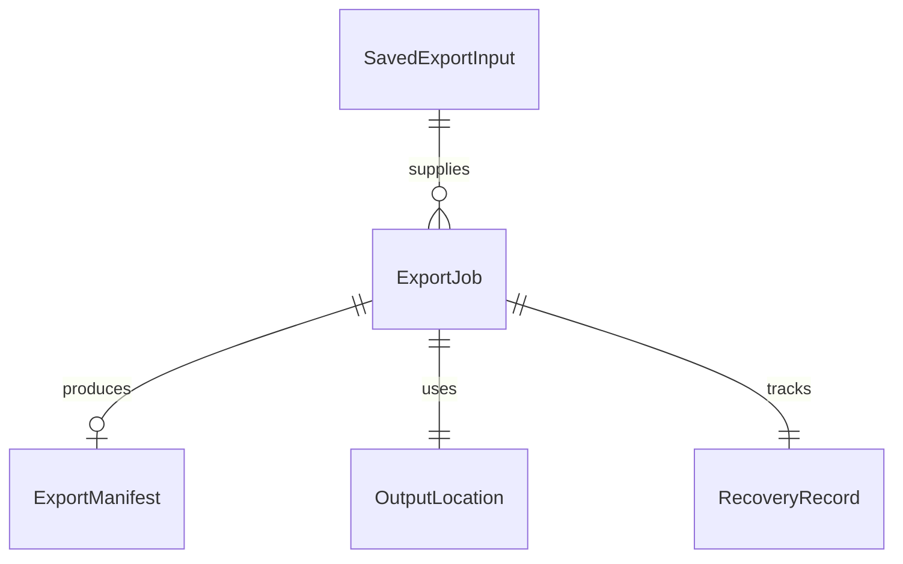

# U3 四枚と記事の安全な出力

## Sources
inceptionのunit-of-work.md、unit-of-work-story-map.md、stories.md US1.4/US1.6/US1.7/US1.8、requirements.md、components.md、contract-summary.md C2/C3に基づく。データ形はentities.mdのYAML、判断規則はrules.mdのYAML、この文書は操作順と状態遷移の正本とする。記事保存と本文投影を複製しない。

## Workflow: 編集中のコピー
1. 現在の編集対象と指紋を取得し、U2の投影からプレーンテキストを得る。不正日付等の入力検証はU2へ委譲する。
2. 画像取得成功・記事の保存を前提にせず、対象が変わっていないことを確認してOSコピー境界へ渡す。
3. 成功時だけコピー成功を示す。失敗はコピー失敗として案内し、本文・dirty・保存済み版を変更しない。画像・相対パス・manifestは混ぜない。

## Workflow: 一式出力
1. 未保存なら保存・取消を求める。保存失敗、結果不明、取消ではジョブを始めない。保存済みの入力と投影のID・指紋・順序を照合する。
2. 保存先を利用者が選択し、アクセス範囲を確保する。選択取消では編集へ戻る。待機中の入力変更を固定前に再検証し、不一致なら再準備する。
3. 新jobIDと不変入力を登録し、その記事の編集・保存・切替・重複開始を抑止する。回復記録を保存できなければ外部生成を始めない。
4. 利用者が選んだ親内に新規のジョブ専用一時領域を作る。生成名は内部識別から安全に発行し、記事名・元名称・写真IDをパスに使わない。同名や領域外参照は失敗とする。
5. 1〜4の順に一枚ずつ取得・変換・書込・解放する。要求IDとjobIDを照合し、期限後の成功や別要求の進捗は採用しない。取得不能は当該番号を示し、記事本文は保つ。
6. U2の固定Markdownをarticle.mdへ、版1のmanifestをmanifest.jsonへ生成する。本文・manifest・四枚の対応、相対パス、ID/保存版/指紋/設定、出力バイトの完了を検証する。
7. 検証済み一式の識別情報を回復記録へ残し、同じ親内の完成名へ非置換で一括確定する。確定の成立を観測した時点が成功と取消の境界である。物理的な原子性・同期方法はNFR設計で実証する。
8. 確定済み結果を記録し、固定プレーンテキストとフォルダ位置を完了画面へ渡す。どの終端でも画像資源と保存先アクセスを解放し、制御を戻す。完成後のコピーやFinder失敗はこの成功を取り消さない。

## State Machine
| 現状態 | 事象 | 次状態・効果 |
|---|---|---|
| preparing | 入力・保存先・記録が有効 | acquiring |
| acquiring | 一枚の成功 | writing。書込後に解放し次の一枚へ戻る |
| writing | 四枚と本文とmanifestが完了 | validating |
| validating | 全整合を確認 | committing |
| committing | 完成名への確定を観測 | succeeded |
| 確定前の実行状態 | 取消・期限・失敗 | 新規処理停止、要求取消、片付け後cancelledまたはfailed |
| 片付け中 | 片付け失敗 | cleanupFailed。残存場所を本人向け表示し成功にしない |
| committing | 確定結果が不明 | needsReconciliation。再生成せず同IDを照合 |
| 任意の未完状態 | 異常終了後に再開 | needsReconciliation。過去の進捗を成功にしない |
| succeeded | 遅い取消・応答 | 同じ成功を維持し副作用を繰り返さない |
| 終端 | 本人が再出力 | 新ID・別フォルダで新規開始 |

cancelled/failed/cleanupFailedを先に表示してから実処理が続く方式にはしない。期限とメモリ予算・中断処理の成立性は次段階で具体化する。閉じる・終了も取消要求を経て収束し、未完のままプロセスが消えた場合は回復へ移る。

## Recovery and Result Reconciliation
回復記録は生成前にジョブ専用領域の識別と固定入力を保持し、通常ログには出さない。起動時は未完の存在を案内し、編集は継続可能とする。保存先アクセスの永続化を前提にせず、照合・片付け時に同じ親を本人が再選択する。保存先の別表記は実体で照合し、所有識別・symlink非使用・範囲を再確認する。

完成先に全一式があり、記録済みjobID/指紋/期待バイト識別と一致した場合だけ過去の確定成功を復元する。完成先があるだけで成功にせず、移動・外部変更・未知版は理由を示して判断を止める。完成物は自動削除しない。未完の一時物は対象を示して片付けを確認し、当該ジョブの所有が証明できる領域だけを削除する。不明なファイル、別ジョブ、旧完成物、保存済み記事へ処理を広げない。

同じjobIDの再要求は登録済みの同一入力なら状態照会として扱い、異入力なら拒否する。成功応答を失った場合も、同じIDで照合するまで新たな生成を行わない。

## Handoff and UI
完了画面のコピーはExportResultの固定本文、編集中のコピーは現在入力である。「Finderで開く」は成功した出力位置の存在とOS結果を確認し、移動・削除・表示失敗を出力失敗とは分けて案内する。本文と画像を本人がnoteへ手動で移す。直接投稿やmanifest送信はしない。

薄い画面接続は、コピー状態、出力前保存確認、保存先選択、進捗/取消、完了、失敗/再試行、未完の照合/片付け案内を持つ。処理中は対象編集を保護し、終端で元操作へ焦点を戻す。全主要操作へTab/Shift+Tabで到達でき、状態は文字で伝える。写真不能でも文章の保存・コピーを継続する。U2の幅・長文条件を引き継ぎ、VoiceOverの追加は要求しない。

## Derived Entity View

テキスト代替：固定入力一つから複数ジョブを作れる。各ジョブは出力場所と回復記録一つを持ち、manifestは生成前には存在せず生成後に一つとなる。図はentities.mdからの派生。構文の識別子・多重度・区切り・方向を照合した。

## Derived Rule Summary
BR3.1/3.9はコピー元と本文形式、BR3.2/3.6は固定と二重実行、BR3.3〜3.5は四枚と一式確定、BR3.7/3.8は取消と回復、BR3.10〜3.12は受渡し・UI・実機確認を規定する。判断の正本はrules.mdである。

## Acceptance and Corners
写真の削除・許可取消・ローカル未取得は番号付き失敗として収束させ、旧記事と成果物を保持する。容量不足、保存先喪失、外部置換、同名、異なるUnicode表記、symlink、途中書込、片付け失敗を正常系と別に試験する。空本文・絵文字・改行・Markdown記号はU2投影を保持し、未知manifest版を自動修復しない。ネットワークサービス、認証/テナント、動画、自動投稿、成果物履歴管理は追加しない。

自動試験は各層のTDD、契約整合、取消と確定の前後、再起動照合、コピー/Finderの失敗注入を含む。製品全体80%と統合前の機能CIを維持する。実時間・実メモリの合否は本人Macで測定し、成功済みで無関係な測定を反復しない。実写真・Sandbox・noteの本人結果をFake成功から推定しない。

## Assumptions & Open Questions
本人の未回答はない。画像期限と予算、原子確定と回復記録の物理方式・権限/同期の成立性はNFR/Infrastructure設計で解決し、未解決のままコード生成へ持ち込まない。
