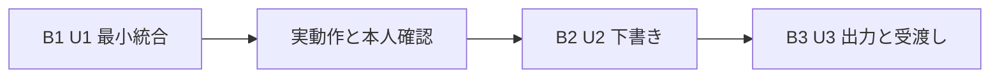

# Phase2 実装計画

## Work Streams
Boltは動く成果物まで仕上げる1回の実装を表す。確認済みの回答と`../units-generation/`、`../contract-design/contract-summary.md`に基づき、3単位をそれぞれ1回のBoltとして進める。全て既存macOSアプリの差分で、別配布物ではない。

| Bolt | Unit | 範囲・成果物 | 相対規模 | 依存 | 利用場面・レビュー観点 |
|---|---|---|---|---|---|
| B1 article-foundation | U1 u1-article-foundation | 最小記事開始・基本編集・独立保存/再開・実画像1枚出力 | L | なし | US1.1〜1.4/1.7の基礎、保存互換性・PhotoKit・Sandbox |
| B2 draft-experience | U2 u2-draft-experience | 編集/再開の利用機能と純粋な本文投影 | L | B1 | US1.1〜1.7の画面/保存調整、日付・未保存保護・狭幅 |
| B3 article-export | U3 u3-article-export | 4枚一式・取消/復旧・OS受渡し | L | B1/B2 | US1.4/1.6〜1.8、固定内容・整合・資源・OS境界 |

詳細担当は`../units-generation/unit-of-work-story-map.md`を正とし、この表の範囲表示だけでACを除外しない。NFR1〜7は全単位の担当部分へ適用する。

## Implementation Sequence
最初の最小統合を実証する順序を優先し、B1→本人確認→B2→B3で進む。Constructionはunit-major・serialを維持し、各Unitの必要な設計とコード生成を終えてから後続Unitへ進む。設計承認だけで動作を実証したとは扱わない。各コード計画の本人承認は別途必要。

### B1: 最小接続の実証
- 対象: U1。既存選択読込、記事正本・保存版、最小編集画面、ローカル画像取得と利用者指定先への1枚出力をつなぐ。後続の型を参照しない。
- 着手条件: 要件・本計画の承認。Functional Designで保存形式・操作ID/競合の照合、NFR/Infrastructure Designで画像API・期限・メモリ予算・Sandboxを具体化。コード変更前に既存回帰試験を実行する。
- 完了条件: 旧schemaVersion 1の選択を変更せず読める。入力を手動保存し、再起動後に文章を再開できる。画像取得不能でも文章を編集・保存できる。未保存離脱/保存失敗で入力と旧正常データを保護する。記事用JPEGを通信なし・元写真非変更で実際に1枚出力し、「画像1枚の検証出力」と明示する。
- 実証する仮説: 写真表示の成功に依存せず記事を保持でき、現在の編集/回転を反映した画像とSandboxの保存先を実経路で接続できる。
- デモ: 本人の既存確定選択→記事開始→日本語入力→保存→再起動/再開→指定先へ1枚出力。取得不能写真で文章が残ることも確認。
- 自動証拠: fixtureの選択→作成→保存/読込→画像変換→出力までの統合経路、UI操作、保存失敗/取消、通信禁止オプションと元データ非変更。実画像だけで成立する条件は本人確認を分離。
- 統合条件: TDD記録、承認済み検証コマンド成功、製品全体80%以上の行カバレッジ、同じコミットのCI成功、本人の実機デモ確認。CIを初回統合前に導入し、未達なら統合しない。

### B2: 下書き制作の完成
- 対象: U2。入口2か所、候補選択、同じ4枚再確定の新規/再開、全本文欄、日付/撮影情報、編集/プレビュー、保存状態と全離脱経路、狭幅・キーボードを完成。
- 着手条件: B1の実証・本人確認、C1/C2の公開型。C3の本文投影/操作ポートを定義し、OS操作はFakeで試験可能にする。
- 完了条件: US1.1〜1.6の担当ACが通る。日付候補は末尾ASCII @YYMMDD、有効日だけで自動補正なし。元写真が取得不能でも文章と撮影情報を保存・コピー用投影できる。全編集値を失わず959/960/961ptの境界、640×560pt、1200×800ptを扱う。200文字の名・各本文1万文字は試験条件であり入力上限ではない。
- 実証する仮説: 週次制作の文章・撮影情報を安全に中断/再開でき、写真なしでも進められる。
- デモ: 候補/複数下書き→編集→保存/再開→狭幅/プレビュー→未保存離脱の3択。コピー本文は現在入力、保存済み表示と混同しない。
- 統合条件: 担当AC・既存回帰・統合/UI試験・80%以上・CI成功。実OSコピーの完成はB3と明記。

### B3: 完成成果物と受渡し
- 対象: U3。保存成功した固定内容、4枚JPEG、article.md、manifest.json、相対参照、毎回別フォルダ、一時生成/確定/取消/復旧、コピー/Finderの実操作と画面接続。
- 着手条件: B1/B2、C1〜C3。保存/投影の照合と一時物確定/異常終了回復の方式、画像資源上限を実装前に確定。
- 完了条件: 4枚・本文・manifestのID/順序/保存版/相対パスが一致した時だけ成功。1枚失敗・容量不足・取消・片付け失敗を成功にしない。旧成果物と下書きを保持する。現在入力のコピーと出力時固定本文のコピーを区別。Finder失敗は出力成功から分離。
- 実証する仮説: 本文と画像の対応を保ち、本人がnoteへ手動で移せる一式を、失敗時も旧データを壊さず生成できる。
- デモ: 未保存→保存確認→出力→Finder→本文貼付け/画像4枚手動挿入。別フォルダの再出力、途中取消、取得不能と再試行も確認。
- 統合条件: 全FR1〜18/NFR1〜7の証拠、80%以上・CI成功、本人の実写真/Sandbox/note確認、既知未確認の明示。

## Detailed Analysis Summary
責務と正本所有は`../domain-design/components.md`、要件は`../requirements-analysis/requirements.md`、依存は`../units-generation/unit-of-work-dependency.md`を入力とする。
18機能要件・7品質要件、8利用場面・37受け入れ条件、5責務・6エンティティ、3Unit・3接続仕様を対象とする。ArticleWorkspaceが記事正本、Presentationが未保存編集、Deliveryが固定ジョブを保持する。選択ストレージと表示用512pxキャッシュを記事出力用へ流用しない。

コード変更の主領域はCoreのモデル/永続化/画像/出力、Appの画面/メニュー/OS境界、各XCTest/UIターゲット、Xcode参照、検証スクリプトとCI設定。ファイル単位の変更一覧・影響範囲・所有は各Code Generation計画で確定する。共有型の変更は契約所有者が影響する全利用側と試験を更新する。後続で既存差分を巻き戻さない。

## Risk Assessment
詳しい確率・影響・回避策は`risk-and-sequencing-rationale.md`。最重要は記事喪失、現在編集画像取得、Sandbox、固定出力の整合、CI環境差。接続仕様のR-01/R-02は受容済みリスクとして引き継ぎ、修正依頼に読み替えない。実装不能な曖昧さがあれば該当設計で明示して解決する。

## Workflow Visualization

テキスト代替: U1の設計・実装・検証と本人確認の後にU2、次にU3を実施する。各単位で設計・コード計画・TDD・試験・CIを行う。構文はflowchart、ノード、引用ラベル、矢印、括弧を確認済み。

## Stage Configuration
承認済みの進行範囲を記載し、この計画で段階を増減しない。
- [x] Functional Design — 全Unitの操作・保存/出力状態と例外条件を具体化。
- [x] NFR Requirements — 全Unitの品質条件、特にU1/U3の期限・資源上限を確定。
- [x] NFR Design — 保存保護・画像予算・取消/確定方式を設計。
- [x] Infrastructure Design — ローカルSandbox・署名・出力先、CI実行環境を設計。
- [x] Code Generation — 各Unitの承認済み計画に従いTDDで実装。
- [x] Build and Test — 既存回帰・各層試験・製品全体80%以上を確認。
- [x] CI Pipeline — 統合前自動試験。最初の統合に必要な最小CIをU1内で導入し、後段で整合確認。
- [ ] Operationの公開/配置等 — 今回対象外。本人のMacでのローカル実行まで。

## Success Criteria
全担当ACを試験へ対応付け、未確認を合格にしない。各Unitで`bash scripts/verify-native.sh`を実行し、Phase2の単体・統合・UI経路をその対象に追加する。製品全体の行カバレッジ80%以上と統合前CIを満たす。本人確認は実写真の編集/回転/色/不要位置情報除去、写真非変更、オフライン、Sandbox、Finder、noteの手動受渡し。VoiceOver追加検証は不要。

GitHub Actionsは公開リポジトリの標準`xcode-27`（arm64、macOS 27）を使い、PR・作業ブランチpush・手動起動で試験する。読取権限・秘密情報なし・合成fixtureのみ。大型runner、有料追加、キャッシュ/成果物アップロードを使わない。実行OS/Xcodeを記録し、SDK不足は黙って対象OSを変えず失敗とする。初回CI成功までは利用可能性を実証済みとしない。

本人の現環境はmacOS 27.2、Xcode 27.2 (27B52)。日本語手順へ実際の署名・Xcode起動・再現コマンド・戻し方を残す。戻す場合は旧アプリ/旧コミットを別作業領域で確認し、現下書きと成果物を退避・保護してから判断する。本人の作業ツリーや保存データを破壊的に戻さない。

料金/対応環境の根拠（2026-11-04確認）: [標準runner](https://docs.github.com/en/actions/reference/runners/github-hosted-runners)、[Xcode 27一般提供](https://github.blog/changelog/2026-10-15-xcode-27-runner-image-generally-available/)。標準runnerの実行は公開リポジトリで無料。その他課金対象の機能を追加する計画ではない。
