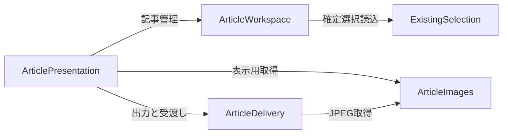

# Phase2 論理コンポーネント

## 入力と範囲
`../requirements-analysis/requirements.md`、`../user-stories/stories.md`、`../practices-discovery/team-practices.md`、`aidlc/spaces/default/codekb/hitotsuzuri/architecture.md`・`component-inventory.md`、本段階の確認済み回答に基づく。5つは論理責務で、配布単位・新規モジュール数・サービス数を意味しない。ExistingSelectionは既存構造の集約表示であり、既存9コンポーネントを削除・再実装する指示ではない。

## Component Catalogue
```yaml
components:
  - name: ExistingSelection
    summary: 既存の写真選択と確定選択の読込境界
    behaviour: >
      既存の探索・確定・保存を維持する。記事側には保存済み選択の読込結果を渡し、
      UIの画像検証成功に依存したlastCommittedだけを唯一の入口にしない。
      記事の書込を受けず、写真ライブラリを変更しない。
    responsibilities:
      - 既存の選択モデル・確定選択の正本
      - 旧形式の読込結果と参照情報の提供
    depends_on: []
    dependents:
      - component: ArticleWorkspace
        interaction: 保存済み選択を読んで記事開始と再確定候補照合に使う
    external_dependencies:
      - name: PhotoKit
        kind: other
        purpose: 既存のライブラリ参照と表示画像取得
      - name: Existing selection storage
        kind: other
        purpose: 既存の設定と確定選択の永続化
    entities:
      - name: CommittedSelection
        identifier: selectionID
        attributes: [schemaVersion, albumID, albumTitle, orderedAssetIDs, confirmedAt]
  - name: ArticleWorkspace
    summary: 記事と保存済み下書きの管理
    behaviour: >
      記事の正本を所有し、作成・読込・手動保存・候補照合を扱う。
      同じ4枚の再確定で新規か既存再開かを本人が選べる候補を返し、
      文章再開を画像取得の成否から分離する。日付候補・撮影メモ・本文投影を扱う。
    responsibilities:
      - 記事・本文・撮影情報・保存リビジョンの所有
      - 選択のスナップショットと再開候補の照合
      - 保存結果と競合・破損・未知版の区別
      - 同じ記事内容からプレビュー・コピー・Markdown用の本文を投影
    depends_on:
      - component: ExistingSelection
        interaction: 保存済み選択を読込む
        style: async
    dependents:
      - component: ArticlePresentation
        interaction: 記事の開始・再開・保存と本文投影を依頼する
    external_dependencies:
      - name: Article storage
        kind: other
        purpose: 写真取得から独立した記事の永続化
    entities:
      - name: ArticleProject
        identifier: projectID
        attributes: [sourceSelectionIDs, sourceAlbumID, sourceAlbumTitle, orderedAssetIDs, selectionRevision, title, introduction, photoTexts, closing, shootingDate, dateCandidateState, location, equipment, film, people, savedRevision, createdAt, updatedAt]
        references:
          - entity: CommittedSelection
            owned_by: ExistingSelection
            relationship: 元の選択IDを来歴として参照し、当時の名称と写真順は記事内に保持する
  - name: ArticlePresentation
    summary: 記事画面と編集操作の調整
    behaviour: >
      入口2か所と下書き選択、編集・プレビュー、手動保存、未保存離脱確認を扱う。
      未保存編集と焦点は保持するが、永続記事の正本は持たない。
      保存成功した内容だけを出力へ渡し、出力中の対象編集を制御する。
    responsibilities:
      - 未保存編集・保存状態・フォーカス・画面の表示状態
      - 新規と再開の本人選択、入力・保存・出力の操作調整
      - 狭幅と長文を含むキーボード到達性
    depends_on:
      - component: ArticleWorkspace
        interaction: 記事管理と本文投影
        style: async
      - component: ArticleImages
        interaction: 記事画面の写真表示と取得不能状態
        style: async
      - component: ArticleDelivery
        interaction: 固定内容の書出し・本文コピー・Finder表示
        style: async
    dependents: []
    external_dependencies:
      - name: Native UI
        kind: other
        purpose: macOSの入力・メニュー・シート・状態表示
    entities:
      - name: ArticleEditSession
        identifier: sessionID
        attributes: [projectID, baseSavedRevision, workingContent, dirtyState, saveState, pendingNavigation, displayMode, focusedField, activeJobID]
        references:
          - entity: ArticleProject
            owned_by: ArticleWorkspace
            relationship: 編集対象と保存時点を参照し、未保存の作業コピーを保持する
          - entity: ExportJob
            owned_by: ArticleDelivery
            relationship: 現在表示する出力ジョブを識別する
  - name: ArticleImages
    summary: 記事用画像の取得と変換
    behaviour: >
      表示用512pxとは契約を分け、用途に必要なローカル画像を取得・変換する。
      現在の編集・回転・sRGB・縮小・不要メタデータ除去を扱い、通信も元写真の変更も行わない。
      取得要求ごとの進捗・取消・期限・資源制御と結果を返す。
    responsibilities:
      - 記事画像要求と一時的な画像結果の所有
      - 編集済み画像の取得・変換・取得不能判定
    depends_on: []
    dependents:
      - component: ArticlePresentation
        interaction: 表示とプレビューの写真を取得する
      - component: ArticleDelivery
        interaction: 固定出力設定のJPEG画像を取得する
    external_dependencies:
      - name: PhotoKit and image processing
        kind: other
        purpose: 読取専用の画像取得と成果物用の画像変換
    entities:
      - name: ArticleImageRequest
        identifier: requestID
        attributes: [assetID, purpose, outputSettings, progress, deadline, cancellationState, result]
  - name: ArticleDelivery
    summary: 固定内容の成果物出力と手動受渡し
    behaviour: >
      保存成功した記事内容の固定コピーを入力にし、出力先選択・一時生成・確定・取消を扱う。
      記事・画像4枚・manifestが完成した場合のみ成功を返し、旧成果物を上書きしない。
      本文コピーとFinder表示のOS操作も担当し、記事の正本は更新しない。
    responsibilities:
      - 出力ジョブ・固定入力・manifest・完了結果の所有
      - Markdownと相対パス、4枚一式の整合
      - 出力先アクセス・一時出力の片付け・再出力
      - クリップボードとFinderへの受渡し
    depends_on:
      - component: ArticleImages
        interaction: 写真順と設定に対応するJPEG結果を取得する
        style: async
    dependents:
      - component: ArticlePresentation
        interaction: 生成・取消・受渡しと状態表示
    external_dependencies:
      - name: Output filesystem and native OS actions
        kind: other
        purpose: 利用者指定先の出力とクリップボード・Finder操作
    entities:
      - name: ExportJob
        identifier: jobID
        attributes: [inputSnapshot, projectID, savedRevision, selectionRevision, orderedAssetIDs, outputSettings, destination, progress, state, temporaryOutput, finalOutput, failure]
        references:
          - entity: ArticleProject
            owned_by: ArticleWorkspace
            relationship: 出力元の識別情報を参照するが固定コピーを使い正本へ書き戻さない
      - name: ExportManifest
        identifier: manifestID
        attributes: [schemaVersion, jobID, projectID, sourceSelectionID, selectionRevision, savedRevision, orderedAssetIDs, relativeImagePaths, articleRelativePath, createdAt, inputFingerprint]
```

## Component Diagram

テキスト代替：画面が記事管理・画像・出力を呼び、記事管理は既存選択を読む。出力は画像を取得する。逆方向の呼出しはない。構文はノード宣言、引用ラベル、矢印、括弧を確認した。

## Component Summary
| Component | Purpose | Depends On | Dependents | Entities Owned |
|---|---|---|---|---|
| ExistingSelection | 既存選択の維持と読込 | なし | ArticleWorkspace | CommittedSelection |
| ArticleWorkspace | 保存済み記事と本文投影 | ExistingSelection | ArticlePresentation | ArticleProject |
| ArticlePresentation | 未保存編集と画面操作 | ArticleWorkspace、ArticleImages、ArticleDelivery | なし | ArticleEditSession |
| ArticleImages | 読取専用の記事画像取得・変換 | なし | ArticlePresentation、ArticleDelivery | ArticleImageRequest |
| ArticleDelivery | 一式出力と手動受渡し | ArticleImages | ArticlePresentation | ExportJob、ExportManifest |

## Entity Ownership
| Entity | Owning Component | Identifier | Attributes | References |
|---|---|---|---|---|
| CommittedSelection | ExistingSelection | selectionID | 形式版・アルバム・順序写真・確定日時 | なし |
| ArticleProject | ArticleWorkspace | projectID | 来歴選択・写真順・本文・撮影情報・保存リビジョン・日時 | CommittedSelection |
| ArticleEditSession | ArticlePresentation | sessionID | 作業本文・基準保存版・未保存状態・焦点・表示・ジョブID | ArticleProject、ExportJob |
| ArticleImageRequest | ArticleImages | requestID | 写真ID・用途・設定・期限・進捗・取消・結果 | 外部写真IDは不透明値 |
| ExportJob | ArticleDelivery | jobID | 固定入力・保存版・写真順・出力先・進捗・結果 | ArticleProject |
| ExportManifest | ArticleDelivery | manifestID | 形式版・ジョブ/記事/選択/保存識別・相対パス・日時・入力識別 | 同じ所有者のExportJobとの対応はjobID |

全属性名は上のYAMLを正とする。ここでは型・値範囲・関係の多重度を定義しない。保存済み記事と未保存編集、出力の固定コピーは別の寿命で、同じ記事の正本を複数所有する意味ではない。来歴IDの参照切れでも当時の写真順と文章を消さない。

## External Dependencies
| Component | Dependency | Kind | Purpose |
|---|---|---|---|
| ExistingSelection | PhotoKit、既存選択保存領域 | other | 既存の写真選択機能 |
| ArticleWorkspace | 記事保存領域 | other | 画像の可否から独立した下書き保存 |
| ArticlePresentation | macOS UI | other | メニュー・フォーム・確認・表示 |
| ArticleImages | PhotoKitと画像変換 | other | 読取専用の現在編集画像を用途へ変換 |
| ArticleDelivery | 出力先ファイルシステム、クリップボード、Finder | other | 成果物と手動受渡し |

保存領域は依存先であり独立した業務コンポーネントではない。技術選定と権限・期限・メモリ予算は後続設計へ残す。

## Rationale
| Component | 分ける理由 | Alternatives Rejected |
|---|---|---|
| ExistingSelection | 既存保存互換性と選択操作を保護する変更境界 | 記事編集を既存Workflowへ集約すると写真依存復元を切り離しにくい |
| ArticleWorkspace | 写真取得から独立した記事の寿命と正本 | 画面だけに保存ロジックを持たせると別入口・再開で同一性が曖昧 |
| ArticlePresentation | 未保存編集・焦点・確認は永続記事と寿命が異なる | 正本をUI/Store両方に置く構成は競合の原因になる |
| ArticleImages | 高解像度画像は512px表示と資源・取消の契約が異なる | 既存表示キャッシュを成果物として流用する構成は画質と編集結果の保証を壊す |
| ArticleDelivery | 出力ジョブと成果物確定は編集と異なる寿命を持つ | 記事保存と出力を同じ書込処理へ混ぜると失敗時の保護範囲が不明確 |

代替Aの5責務は接続が増える一方、写真なし文章再開・旧形式保護・出力取消を個別試験しやすい。代替Bの既存選択への記事集約は初期接続が少ない一方、既存選択の状態変更範囲が広い。本人はAを選択し要約確認した。配置単位は後で変えられるが、正本の所有・固定出力という境界は保つ。判断記録は`decisions.md`。
