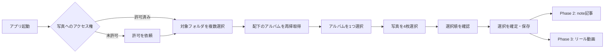

# ひとつづり — Phase 1 設計・技術構成・実装手順

アプリ表示名は「ひとつづり」、リポジトリ名は`hitotsuzuri`、Xcodeプロジェクト名は`Hitotsuzuri`とする。

> [!note] この設計書の位置づけ
> 参照会話の設計回答本文を取得できなかったため、確認できた要件を基に再構成した設計案。元回答との一致は未確認であり、AI-DLCのInceptionで要件と技術的な成立性を確認する。Swiftコードは実装時に検証する参考例とする。

> [!summary]
> macOSの「写真」アプリで管理しているアルバムを、指定した複数フォルダ以下から再帰的に探し、対象アルバムを1つ選び、その中から写真を4枚選ぶためのmacOSネイティブアプリをSwiftUIで実装する。
>
> Phase 1では、週次ワークフローの入口となる「探す・選ぶ・選択内容を保持する」までを完成させる。note記事の作成とリール動画の生成は、Phase 1のデータを利用する後続フェーズとする。

## 1. 背景と目的

写真はmacOSの「写真」アプリで管理しており、撮影日や企画ごとにアルバムが作成されている。

アルバム名の例：

- `御代田 PENTAX 6x7 Portra 160@260913`
- `情景ポートレートShinya写真教室 白川うみ 寺尾彗@260927`

これらのアルバムはフォルダで整理されている。フォルダは複数指定でき、さらにその配下にサブフォルダが存在する場合がある。

最終的な週次ワークフローは次のとおり。

1. 対象とする写真フォルダを指定する
2. 指定フォルダ以下のアルバムから1つ選ぶ
3. アルバム内の写真から4枚を選ぶ
4. 選んだ4枚を使ってnoteの記事を作る
5. 選んだ4枚を使ってリール用動画を作る

Phase 1では、1〜3をmacOSネイティブアプリとして実装する。

## 2. Phase 1のスコープ

### 2.1 実装する機能

- [ ] macOS「写真」ライブラリへのアクセス許可を取得する
- [ ] 写真アプリのユーザーフォルダを階層表示する
- [ ] 対象フォルダを複数選択できるようにする
- [ ] 選択したフォルダの全サブフォルダを再帰的に探索する
- [ ] 配下にあるユーザー作成アルバムを一覧表示する
- [ ] 一覧から対象アルバムを1つ選択する
- [ ] アルバム内の写真をサムネイルのグリッドで表示する
- [ ] 写真を最大4枚まで選択できるようにする
- [ ] 選択順を1〜4の番号で表示する
- [ ] 4枚選択した時点で「選択を確定」を有効にする
- [ ] 選んだフォルダ、アルバム、写真の識別子をローカルに保存する
- [ ] 次回起動時に、可能な範囲で前回の状態を復元する
- [ ] 写真ライブラリの変更を検知し、表示を更新する

### 2.2 Phase 1では実装しない機能

- noteへの自動投稿・下書き作成
- 記事本文の自動生成
- 動画の生成、トランジション、BGM、テロップ
- InstagramなどSNSへの投稿
- クラウド同期
- 毎週の自動実行・通知
- 写真ファイルの恒久的な複製管理

これらは、Phase 1で確定した4枚を入力としてPhase 2以降に追加する。

## 3. 完成時の利用フロー



## 4. 画面設計

### 4.1 基本レイアウト

macOSらしい3カラム構成とする。`NavigationSplitView`を使い、フォルダ・アルバム・写真の関係を常に把握できるようにする。

| 領域 | 表示内容 | 主な操作 |
|---|---|---|
| サイドバー | 写真フォルダの階層 | 対象フォルダを複数選択 |
| コンテンツ | 対象フォルダ配下のアルバム一覧 | アルバムを1つ選択 |
| 詳細 | 選択アルバム内の写真グリッド | 4枚を選択・選択解除 |
| 下部バー | 選択枚数、選択順、確定ボタン | 選択内容を確定 |

### 4.2 画面状態

#### 初回起動

- アプリの目的を短く説明する
- 「写真へのアクセスを許可」ボタンを表示する
- 拒否された場合は、システム設定を開く案内を表示する

#### フォルダ未選択

- サイドバーにフォルダ階層を表示する
- 詳細側には「対象フォルダを選択してください」と表示する

#### フォルダ選択済み・アルバム未選択

- 選択フォルダ配下のアルバムを一覧表示する
- 各行にアルバム名、写真枚数、代表サムネイルを表示する
- 検索欄でアルバム名を絞り込めるようにする

#### アルバム選択済み

- 写真を撮影日時順でグリッド表示する
- 写真をクリックすると選択状態になる
- 選択した写真にはチェックと選択順 `1`〜`4` を重ねる
- 4枚選択済みの場合、5枚目は選択できない
- 選択済みの写真を再度クリックすると解除し、残りの番号を詰める

#### 4枚選択済み

- 「4 / 4枚」を表示する
- 「選択を確定」ボタンを有効にする
- 確定後は4枚のプレビューと選択したアルバム名を表示する

## 5. 技術構成

### 5.1 採用技術

| 項目 | 採用技術 | 用途 |
|---|---|---|
| UI | SwiftUI | macOSネイティブUI |
| 写真ライブラリ | PhotoKit | フォルダ、アルバム、写真の取得 |
| 状態管理 | Observation（`@Observable`） | 画面状態と選択状態 |
| 画面分割 | `NavigationSplitView` | 3カラムUI |
| 画像取得 | `PHCachingImageManager` | サムネイルの非同期取得とキャッシュ |
| 設定保存 | `UserDefaults` / `@AppStorage` | 選択フォルダなど軽量設定の保存 |
| セッション保存 | `Codable` + JSON | 確定した4枚とアルバム情報の保存 |
| 変更監視 | `PHPhotoLibraryChangeObserver` | 写真ライブラリ変更への追従 |
| テスト | XCTest / Swift Testing | 選択ルール、探索、保存処理の検証 |

### 5.2 対象環境

- Swift 5.9以降
- SwiftUI
- macOS 14以降を推奨
- XcodeのmacOS Appテンプレート
- App Sandboxを有効化

> [!note]
> Phase 1はMac App Store配布を必須としない。まずローカル実行でPhotoKit連携と選択体験を完成させ、その後に署名・配布方法を決める。

### 5.3 必要な設定

`Info.plist`に写真ライブラリの利用目的を追加する。

```xml
<key>NSPhotoLibraryUsageDescription</key>
<string>アルバムから記事と動画に使う写真を選ぶため、写真ライブラリを参照します。</string>
```

Phase 1は読み取りのみを基本とする。写真ライブラリへアセットを書き戻す機能は追加しない。

## 6. アーキテクチャ

小規模なPhase 1では、MVVMを基礎にしつつ、PhotoKitへのアクセスをサービス層へ分離する。

```text
Hitotsuzuri
├── App
│   └── HitotsuzuriApp.swift
├── Models
│   ├── PhotoFolderNode.swift
│   ├── PhotoAlbum.swift
│   ├── PhotoAsset.swift
│   └── PhotoSelectionSession.swift
├── Services
│   ├── PhotoLibraryAuthorizationService.swift
│   ├── PhotoLibraryRepository.swift
│   ├── ThumbnailService.swift
│   └── SelectionPersistenceService.swift
├── Features
│   └── PhotoPicker
│       ├── PhotoPickerStore.swift
│       ├── PhotoPickerView.swift
│       ├── FolderSidebarView.swift
│       ├── AlbumListView.swift
│       ├── PhotoGridView.swift
│       └── SelectionTrayView.swift
├── Components
│   ├── ThumbnailView.swift
│   ├── EmptyStateView.swift
│   └── PermissionView.swift
└── Tests
    ├── FolderTraversalTests.swift
    ├── PhotoSelectionTests.swift
    └── SelectionPersistenceTests.swift
```

### 6.1 責務分担

#### View

- 画面描画
- ユーザー操作の受け取り
- Storeが公開する状態の表示
- PhotoKit APIを直接呼ばない

#### PhotoPickerStore

- 権限状態
- 選択中のフォルダ群
- 表示対象アルバム
- 選択中のアルバム
- 表示対象写真
- 選択された4枚とその順序
- ローディング、空状態、エラー状態

#### PhotoLibraryRepository

- PhotoKitオブジェクトの取得
- フォルダ階層の構築
- サブフォルダの再帰探索
- アルバム内アセットの取得
- PhotoKitの型を画面用モデルへ変換

#### ThumbnailService

- サムネイルの非同期読み込み
- 先読みとキャッシュ
- 画面外になったリクエストのキャンセル

#### SelectionPersistenceService

- 選択フォルダのlocal identifierを保存
- 確定セッションをJSONとして保存
- 次回起動時の復元

## 7. データモデル

PhotoKitのオブジェクトをそのままViewに渡さず、安定した識別子を持つ表示用モデルへ変換する。

```swift
import Foundation

struct PhotoFolderNode: Identifiable, Hashable, Codable {
    let id: String                 // PHCollectionList.localIdentifier
    let title: String
    var childFolders: [PhotoFolderNode]
    var albumIDs: [String]
}

struct PhotoAlbum: Identifiable, Hashable, Codable {
    let id: String                 // PHAssetCollection.localIdentifier
    let title: String
    let assetCount: Int
    let parentFolderID: String?
}

struct PhotoAsset: Identifiable, Hashable, Codable {
    let id: String                 // PHAsset.localIdentifier
    let creationDate: Date?
    let pixelWidth: Int
    let pixelHeight: Int
    let isFavorite: Bool
}

struct PhotoSelectionSession: Identifiable, Codable {
    let id: UUID
    let createdAt: Date
    let albumID: String
    let albumTitle: String
    let orderedAssetIDs: [String]  // 必ず4件
}
```

> [!important]
> `localIdentifier`は写真ライブラリ内の参照を復元するために使う。アセットが削除された、別ライブラリへ切り替えた、または識別子が無効になった場合には復元できないため、起動時に必ず存在確認を行う。

## 8. PhotoKitの扱い

### 8.1 アクセス許可

```swift
import Photos

enum PhotoLibraryAccessState: Equatable {
    case notDetermined
    case authorized
    case limited
    case denied
    case restricted
}

struct PhotoLibraryAuthorizationService {
    func currentStatus() -> PhotoLibraryAccessState {
        map(PHPhotoLibrary.authorizationStatus(for: .readWrite))
    }

    func requestAccess() async -> PhotoLibraryAccessState {
        await withCheckedContinuation { continuation in
            PHPhotoLibrary.requestAuthorization(for: .readWrite) { status in
                continuation.resume(returning: map(status))
            }
        }
    }

    private func map(_ status: PHAuthorizationStatus) -> PhotoLibraryAccessState {
        switch status {
        case .notDetermined: .notDetermined
        case .authorized: .authorized
        case .limited: .limited
        case .denied: .denied
        case .restricted: .restricted
        @unknown default: .denied
        }
    }
}
```

### 8.2 フォルダ階層とアルバムの再帰取得

写真アプリのフォルダは`PHCollectionList`、通常のアルバムは`PHAssetCollection`として扱う。

```swift
import Photos

struct AlbumReference: Hashable {
    let id: String
    let title: String
    let parentFolderID: String?
    let collection: PHAssetCollection

    static func == (lhs: AlbumReference, rhs: AlbumReference) -> Bool {
        lhs.id == rhs.id
    }

    func hash(into hasher: inout Hasher) {
        hasher.combine(id)
    }
}

final class PhotoLibraryRepository {
    func fetchTopLevelCollections() -> PHFetchResult<PHCollection> {
        PHCollectionList.fetchTopLevelUserCollections(with: nil)
    }

    func collectAlbums(
        under folder: PHCollectionList,
        visitedFolderIDs: inout Set<String>
    ) -> [AlbumReference] {
        guard visitedFolderIDs.insert(folder.localIdentifier).inserted else {
            return []
        }

        let children = PHCollectionList.fetchCollections(in: folder, options: nil)
        var result: [AlbumReference] = []

        children.enumerateObjects { collection, _, _ in
            if let album = collection as? PHAssetCollection {
                result.append(
                    AlbumReference(
                        id: album.localIdentifier,
                        title: album.localizedTitle ?? "名称未設定のアルバム",
                        parentFolderID: folder.localIdentifier,
                        collection: album
                    )
                )
            } else if let childFolder = collection as? PHCollectionList {
                result.append(
                    contentsOf: self.collectAlbums(
                        under: childFolder,
                        visitedFolderIDs: &visitedFolderIDs
                    )
                )
            }
        }

        return result
    }

    func fetchAssets(in album: PHAssetCollection) -> PHFetchResult<PHAsset> {
        let options = PHFetchOptions()
        options.sortDescriptors = [
            NSSortDescriptor(key: "creationDate", ascending: true)
        ]
        options.predicate = NSPredicate(
            format: "mediaType == %d",
            PHAssetMediaType.image.rawValue
        )
        return PHAsset.fetchAssets(in: album, options: options)
    }
}
```

複数の親フォルダが選択された場合は、各フォルダを再帰探索した結果を`album.localIdentifier`で重複排除する。

```swift
func deduplicatedAlbums(_ groups: [[AlbumReference]]) -> [AlbumReference] {
    var seen = Set<String>()
    return groups
        .flatMap { $0 }
        .filter { seen.insert($0.id).inserted }
        .sorted {
            $0.title.localizedStandardCompare($1.title) == .orderedAscending
        }
}
```

### 8.3 サムネイル取得

```swift
import AppKit
import Photos

final class ThumbnailService {
    private let imageManager = PHCachingImageManager()

    @discardableResult
    func requestThumbnail(
        for asset: PHAsset,
        size: CGSize,
        completion: @escaping (NSImage?) -> Void
    ) -> PHImageRequestID {
        let options = PHImageRequestOptions()
        options.deliveryMode = .opportunistic
        options.resizeMode = .fast
        options.isNetworkAccessAllowed = true

        return imageManager.requestImage(
            for: asset,
            targetSize: size,
            contentMode: .aspectFill,
            options: options
        ) { image, _ in
            completion(image)
        }
    }

    func cancel(_ requestID: PHImageRequestID) {
        imageManager.cancelImageRequest(requestID)
    }
}
```

Retinaディスプレイでは、Viewのポイントサイズに`NSScreen.backingScaleFactor`を掛けたピクセルサイズを`targetSize`として渡す。

## 9. 選択状態の実装

4枚制限と選択順はStore側で一元管理する。View側に同じロジックを分散させない。

```swift
import Observation

@MainActor
@Observable
final class PhotoPickerStore {
    private(set) var selectedAssetIDs: [String] = []
    var selectedAlbumID: String?
    var selectedFolderIDs = Set<String>()
    var errorMessage: String?

    let selectionLimit = 4

    var canConfirm: Bool {
        selectedAssetIDs.count == selectionLimit
    }

    func selectionNumber(for assetID: String) -> Int? {
        guard let index = selectedAssetIDs.firstIndex(of: assetID) else {
            return nil
        }
        return index + 1
    }

    func toggleAsset(id assetID: String) {
        if let index = selectedAssetIDs.firstIndex(of: assetID) {
            selectedAssetIDs.remove(at: index)
            return
        }

        guard selectedAssetIDs.count < selectionLimit else {
            errorMessage = "選択できる写真は4枚までです。"
            return
        }

        selectedAssetIDs.append(assetID)
    }

    func selectAlbum(id albumID: String) {
        guard selectedAlbumID != albumID else { return }
        selectedAlbumID = albumID
        selectedAssetIDs.removeAll()
    }
}
```

### 9.1 グリッドの最小実装例

```swift
import SwiftUI

struct PhotoGridView: View {
    let assets: [PhotoAsset]
    @Bindable var store: PhotoPickerStore

    private let columns = [
        GridItem(.adaptive(minimum: 140, maximum: 220), spacing: 8)
    ]

    var body: some View {
        ScrollView {
            LazyVGrid(columns: columns, spacing: 8) {
                ForEach(assets) { asset in
                    let number = store.selectionNumber(for: asset.id)

                    ThumbnailView(assetID: asset.id)
                        .aspectRatio(1, contentMode: .fill)
                        .clipShape(RoundedRectangle(cornerRadius: 8))
                        .overlay(alignment: .topTrailing) {
                            if let number {
                                Text("\(number)")
                                    .font(.headline)
                                    .foregroundStyle(.white)
                                    .frame(width: 30, height: 30)
                                    .background(.blue, in: Circle())
                                    .padding(8)
                            }
                        }
                        .overlay {
                            RoundedRectangle(cornerRadius: 8)
                                .stroke(
                                    number == nil ? .clear : .blue,
                                    lineWidth: 4
                                )
                        }
                        .contentShape(Rectangle())
                        .onTapGesture {
                            store.toggleAsset(id: asset.id)
                        }
                        .accessibilityLabel("写真")
                        .accessibilityValue(
                            number.map { "選択順\($0)" } ?? "未選択"
                        )
                }
            }
            .padding()
        }
    }
}
```

`ThumbnailView`は`ThumbnailService`と`PHAsset.localIdentifier`から画像を読み込む専用コンポーネントとして実装する。

## 10. アプリのエントリポイント

```swift
import SwiftUI

@main
struct HitotsuzuriApp: App {
    @State private var store = PhotoPickerStore()

    var body: some Scene {
        WindowGroup {
            PhotoPickerView(store: store)
                .frame(minWidth: 980, minHeight: 640)
        }
        .defaultSize(width: 1280, height: 800)

        Settings {
            HitotsuzuriSettingsView()
        }
    }
}
```

メイン画面は次の骨格とする。

```swift
import SwiftUI

struct PhotoPickerView: View {
    @Bindable var store: PhotoPickerStore

    var body: some View {
        NavigationSplitView {
            FolderSidebarView(store: store)
                .navigationTitle("フォルダ")
        } content: {
            AlbumListView(store: store)
                .navigationTitle("アルバム")
        } detail: {
            VStack(spacing: 0) {
                PhotoGridContainerView(store: store)
                Divider()
                SelectionTrayView(store: store)
            }
            .navigationTitle("写真を4枚選択")
        }
    }
}
```

## 11. 永続化方針

### 11.1 保存する内容

`UserDefaults`：

- 選択対象フォルダのlocal identifier配列
- アルバムの並び順
- サムネイルサイズ
- 最後に開いたアルバムのlocal identifier

JSONファイル：

- `PhotoSelectionSession`
- アルバム名
- 選択した4枚のlocal identifierと順序
- 確定日時

### 11.2 保存しない内容

- 写真のバイナリ本体
- サムネイルの恒久キャッシュ
- PhotoKitオブジェクトそのもの

### 11.3 復元時のルール

1. 保存された識別子をPhotoKitで再取得する
2. 存在しないフォルダ・アルバム・写真を除外する
3. 4枚すべて復元できなければ未確定状態に戻す
4. ユーザーへ「一部の写真が見つからないため、選び直してください」と表示する

## 12. 写真ライブラリ変更への対応

アプリ起動中に写真アプリ側でアルバムや写真が変更される可能性があるため、`PHPhotoLibraryChangeObserver`を登録する。

```swift
import Photos

final class PhotoLibraryChangeMonitor: NSObject, PHPhotoLibraryChangeObserver {
    var onChange: (() -> Void)?

    override init() {
        super.init()
        PHPhotoLibrary.shared().register(self)
    }

    deinit {
        PHPhotoLibrary.shared().unregisterChangeObserver(self)
    }

    func photoLibraryDidChange(_ changeInstance: PHChange) {
        DispatchQueue.main.async { [weak self] in
            self?.onChange?()
        }
    }
}
```

初期実装では変更時に対象データを安全に再取得する。性能上の必要が出た場合のみ、`PHFetchResultChangeDetails`を使った差分更新へ進める。

## 13. エラーと空状態

| 状態 | 表示・動作 |
|---|---|
| 写真アクセス未許可 | 許可の目的と許可ボタンを表示 |
| アクセス拒否 | システム設定の案内を表示 |
| 選択フォルダが0件 | フォルダ選択を促す |
| 配下にアルバムがない | 「アルバムが見つかりません」 |
| アルバム内に写真がない | 「このアルバムには写真がありません」 |
| 写真が4枚未満 | ある枚数だけ表示し、確定は無効 |
| iCloud写真が未ダウンロード | ローディング表示。ネットワーク取得を許可 |
| アセットが削除された | 選択から除外し、再選択を促す |
| ライブラリが切り替わった | 保存IDを検証し、無効な状態をリセット |

## 14. 性能設計

- `LazyVGrid`で画面内のセルだけを構築する
- 一覧では原寸画像を要求せず、表示サイズ相当のサムネイルを要求する
- `PHCachingImageManager`で表示範囲の前後を先読みする
- スクロールで不要になった画像リクエストをキャンセルする
- フォルダ探索結果は、写真ライブラリの変更があるまでメモリ上でキャッシュする
- アルバムの代表画像と枚数は必要になった時点で遅延取得する
- PhotoKitの取得とSwiftUIの状態更新を分け、UI更新はMainActor上で行う

## 15. テスト方針

PhotoKitそのものはテスト環境への依存が強いため、プロトコルでRepositoryを抽象化し、Storeの単体テストではFakeを使う。

### 15.1 単体テスト

- [ ] 0枚から4枚まで順番に選べる
- [ ] 5枚目を選択できない
- [ ] 2枚目を解除すると、3・4枚目の番号が詰まる
- [ ] アルバムを変更すると写真選択がクリアされる
- [ ] 同じアルバムが複数の探索結果にあっても重複しない
- [ ] 多段サブフォルダのアルバムを取得できる
- [ ] 保存したセッションを同じ順序で復元できる
- [ ] 写真が1枚欠けたセッションを未確定として扱う

### 15.2 手動テスト用ライブラリ

写真アプリに以下の構造を用意する。

```text
Hitotsuzuri Test
├── 2026
│   ├── Portrait
│   │   ├── Album A（10枚）
│   │   └── Album B（3枚）
│   └── Landscape
│       └── Album C（100枚以上）
└── Archive
    └── Album D（iCloud上のみの写真を含む）
```

確認項目：

- [ ] `Hitotsuzuri Test`だけでA〜Dを取得できる
- [ ] `Portrait`と`Landscape`を同時に選択できる
- [ ] 3枚しかないAlbum Bでは確定できない
- [ ] 100枚以上でもスクロールが滑らかである
- [ ] iCloud上の写真が必要に応じて読み込まれる
- [ ] 写真アプリ側で写真を削除した時に破綻しない
- [ ] アプリ再起動後に対象フォルダが復元される

## 16. 実装手順

### Step 1 — プロジェクト作成

- [ ] XcodeでmacOS Appを新規作成する
- [ ] Product Nameを`Hitotsuzuri`、アプリ表示名を「ひとつづり」にする
- [ ] リポジトリ名を`hitotsuzuri`にする
- [ ] InterfaceにSwiftUIを選ぶ
- [ ] LanguageにSwiftを選ぶ
- [ ] Git管理を有効にする
- [ ] macOS Deployment Targetを決める
- [ ] App Sandboxを有効にする
- [ ] `NSPhotoLibraryUsageDescription`を追加する

### Step 2 — アクセス許可

- [ ] `PhotoLibraryAuthorizationService`を作る
- [ ] 現在の権限状態を画面に反映する
- [ ] 未決定時だけ許可ダイアログを表示する
- [ ] 拒否・制限時の案内画面を作る
- [ ] 許可後にライブラリ読み込みを開始する

### Step 3 — PhotoKit探索層

- [ ] `PhotoLibraryRepository`を作る
- [ ] トップレベルのユーザーコレクションを取得する
- [ ] `PHCollectionList`をフォルダとして階層化する
- [ ] サブフォルダを再帰探索する
- [ ] `PHAssetCollection`をアルバムとして抽出する
- [ ] 複数フォルダの結果を識別子で重複排除する
- [ ] ループ防止用のvisited setを入れる

### Step 4 — フォルダ選択UI

- [ ] `NavigationSplitView`を配置する
- [ ] `FolderSidebarView`を作る
- [ ] DisclosureGroupなどで階層を表示する
- [ ] 複数フォルダを選択できるようにする
- [ ] 選択フォルダIDを保存する
- [ ] フォルダ選択の変化でアルバム一覧を更新する

### Step 5 — アルバム一覧

- [ ] `AlbumListView`を作る
- [ ] アルバム名を表示する
- [ ] 写真枚数を表示する
- [ ] 代表サムネイルを表示する
- [ ] 名前検索を追加する
- [ ] アルバム選択時に写真一覧を読み込む

### Step 6 — 写真グリッド

- [ ] `ThumbnailService`を作る
- [ ] `ThumbnailView`を作る
- [ ] `LazyVGrid`でサムネイルを表示する
- [ ] 画面サイズに応じた可変カラムにする
- [ ] iCloud上の画像取得を許可する
- [ ] リクエストのキャンセルとキャッシュを実装する

### Step 7 — 4枚選択

- [ ] `PhotoPickerStore`に選択配列を追加する
- [ ] 選択順を保持する
- [ ] 選択番号を写真上に表示する
- [ ] 最大4枚の制限を実装する
- [ ] 選択解除後に番号を振り直す
- [ ] `4 / 4枚`のカウンターを表示する
- [ ] 4枚選択時だけ確定ボタンを有効にする

### Step 8 — 確定と保存

- [ ] `PhotoSelectionSession`を生成する
- [ ] JSONへ保存する
- [ ] 次回起動時に識別子を検証して復元する
- [ ] 復元できないアセットがある場合の案内を実装する
- [ ] 確定後の4枚プレビューを作る

### Step 9 — ライブラリ変更監視

- [ ] `PHPhotoLibraryChangeObserver`を登録する
- [ ] フォルダ・アルバム・写真の変更時に再取得する
- [ ] 削除された選択写真を安全に取り除く
- [ ] Viewの終了時に監視を解除する

### Step 10 — テストと調整

- [ ] 選択ルールの単体テストを書く
- [ ] 再帰探索のテストを書く
- [ ] 保存と復元のテストを書く
- [ ] 大きなアルバムで性能を確認する
- [ ] VoiceOverラベルとキーボード操作を確認する
- [ ] 空状態とエラー表示を確認する

## 17. Phase 1の受け入れ条件

以下をすべて満たせばPhase 1完了とする。

- [ ] アプリから写真ライブラリへの読み取り許可を取得できる
- [ ] 写真アプリのフォルダ階層を表示できる
- [ ] 対象フォルダを2つ以上同時に指定できる
- [ ] 3階層以上のサブフォルダにあるアルバムも一覧に現れる
- [ ] アルバムを1つ選び、その中の写真を閲覧できる
- [ ] 写真を選んだ順番が1〜4で視覚的に分かる
- [ ] 5枚目を誤って選択できない
- [ ] 4枚そろうまで確定できない
- [ ] 確定した4枚の順序と識別子を保存できる
- [ ] アプリ再起動後に、有効な選択状態を復元できる
- [ ] 写真やアルバムが削除されてもクラッシュしない
- [ ] 100枚以上のアルバムで実用的に操作できる

## 18. Phase 2以降への接続

Phase 1の出力は`PhotoSelectionSession`とする。後続機能はこのモデルを入力にすれば、写真選択UIと疎結合にできる。

### Phase 2 — note記事作成支援

- 選択した4枚を一時書き出し
- アルバム名の`@YYMMDD`部分から撮影日を抽出
- アルバム名から場所、機材、フィルム、人物名などの候補を抽出
- 記事タイトルと本文のテンプレートを生成
- Markdownまたはクリップボードへ出力
- noteへの自動連携可否は、当時の公開API・利用規約を確認して決定

### Phase 3 — リール動画作成

- AVFoundationで縦型動画を生成
- 4枚の表示順はPhase 1の選択順を使用
- 画像ごとの表示時間、トランジション、Ken Burns効果
- タイトル、撮影日、クレジットのテロップ
- BGMの選択と音量調整
- 1080 × 1920などのプリセット出力

### Phase 4 — 週次運用

- 未処理アルバムの候補表示
- 前回確定した日時以降のアルバムを優先
- 毎週のリマインダー
- 記事・動画作成済みフラグ
- 履歴画面と再編集

## 19. 設計上の判断

### なぜmacOSネイティブアプリか

- 写真アプリとの統合にPhotoKitを直接利用できる
- 大量のサムネイルを自然なMac UIで扱える
- ドラッグ＆ドロップ、キーボード操作、ファイル書き出しへ拡張しやすい
- 将来AVFoundationによる動画生成を同一アプリに追加しやすい

### なぜ最初からnote・動画まで作らないか

もっとも不確実なのは、写真ライブラリのフォルダ構造を正しく読み取り、週次で迷わず4枚を選べるかどうかである。Phase 1でこの中核体験を検証してから、同じ確定データを記事と動画に接続する方が、仕様変更の影響を小さくできる。

### なぜ写真本体を保存しないか

Phase 1では写真ライブラリを正として参照だけを保存する。重複ファイルやストレージ消費を避けられる。外部サービス連携や動画生成を実行する段階でのみ、一時ディレクトリへ必要解像度の画像を書き出す。

## 20. 最初の開発マイルストーン

### Milestone A — ライブラリを読める

- [ ] アクセス許可
- [ ] フォルダ階層表示
- [ ] 再帰的なアルバム取得

### Milestone B — 4枚を選べる

- [ ] アルバム選択
- [ ] サムネイルグリッド
- [ ] 4枚制限と選択順

### Milestone C — 毎週使える

- [ ] 状態保存と復元
- [ ] エラー・空状態
- [ ] ライブラリ変更対応
- [ ] 性能と操作性の調整

---

## 関連ノート

- [[ひとつづり]]
- [[ひとつづり Phase 2 note記事作成]]
- [[ひとつづり Phase 3 リール動画作成]]
- [[ひとつづり テスト計画]]

## 更新履歴

- 2026-10-28: Phase 1の設計、技術構成、Swiftコード例、実装手順、受け入れ条件を統合して作成。
- 2026-10-28: アプリ名を「ひとつづり」、プロジェクト名を`Hitotsuzuri`、リポジトリ名を`hitotsuzuri`に統一。設計書の出典と検証状況を明記。
